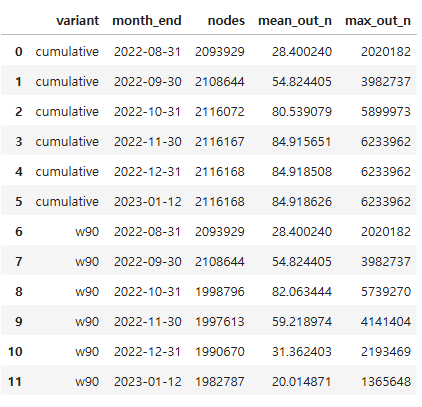
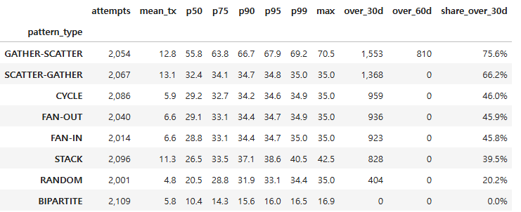

# 카운트형 노드 피처의 누적창 vs 고정창
노드 피처를 데이터 시작일부터 전체 누적으로 계산한다. 그러면 log_out_count 같은 카운트형 피처는 시간이 갈수록 단조 증가하고, 값이 "계좌 성격"이 아니라 "달력"을 담을 수 있다.
이게 문제가 될 수 있나 없나를 확인하기 위해 하는 과정임

월별로 세탁 계좌 vs 정상 계좌의 피처 분포 차이(단변량 AUC)가 일정하게 유지되는가?를 보면서 뒤로 갈수록 AUC 가 떨어지면 누적 창이 신호를 희석하는 것이고, 고정 창(예: 90일)으로 바꿀 근거가 된다.

### 월말마다 카운트형 노드 피처 계산
- nodes : 그 창 안에서 한 번이라도 거래한(송금 또는 수취) 계좌 수
- mean_out_n : 그 계좌들의 평균 송금 건수 (ln 변환 전 원시값)
- max_out_n : 가장 많이 송금한 계좌 한 개의 건수

cumulative (0~5행) — 데이터 시작부터 누적

### 추가 GATHER-SCATTER 최대 약 70.45일, STACK 최대 약 42.51일로 나왔었는데 이게 이상치 인건지 아니면 전체적으로 높은건지 확인
- GATHER-SCATTER 만 전체적으로 높게 주기 길다.

