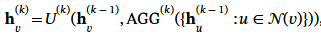
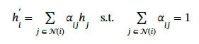
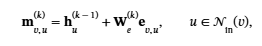
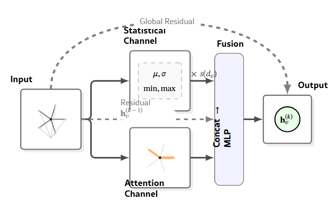
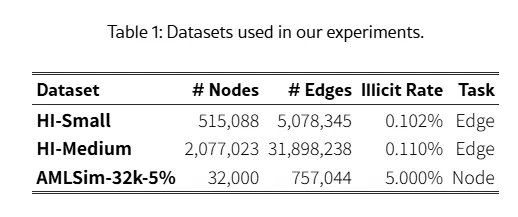
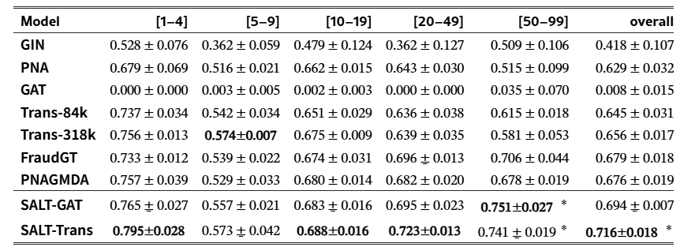
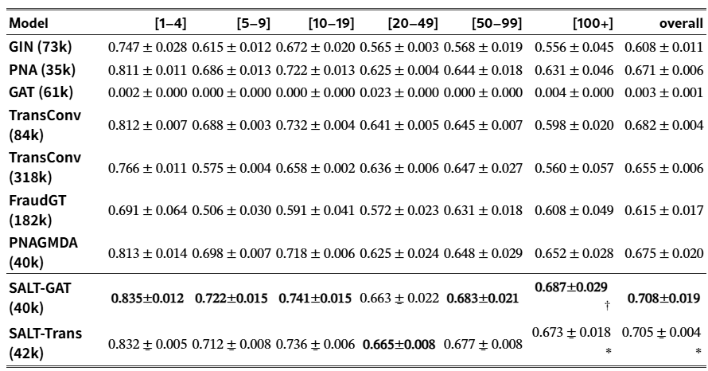
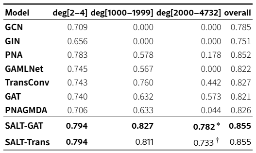
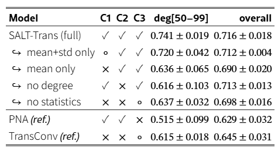

# SALT-GNN: Handling Dense Neighborhoods in Anti-Money Laundering Graphs via Statistics-Aware Attention

## 1 Introduction

GNN의 성능은 **수신자 연결 정도(recipient in-degree)** 가 높은 환경에서 어려운데 이유는 
1. 탐지가 기술적으로 어렵고
2. 운영 비용이 많이 들기 때문이고
이문제를 해결하는 방법은 용량을 늘리거나 튜닝을 하는 것만으로 해결되는 것은 아니다. 어텐션은 방대한 백그라운드 활동속에서 관련성이 높은 이웃에 선택적으로 초점을 맞출 수 있기 때문에 자금세탁방지(AML)에서 여전히 유용하다. 다만, 수신자 밀도가 증감에 따라 어텐션이 취약해진다는 한계가 있다.  

- 간선 분류니까 판정 대상은 거래 u→v 이고, 그 거래의 "환경"은 v(받는 계좌)가 얼마나 많은 거래를 받고 있느냐로 정의. 논문 표현이 "거래는 수신자의 문맥을 물려받는다"
- v로 들어오는 거래 수백 건 중 세탁 한 건을 찾는 건데, 메시지 패싱이 v의 이웃을 평균 내버리면 그 한 건이 묻히고, attention도 이웃이 많아질수록 가중치가 1/N로 퍼져서 약한 신호가 "패턴이 완성되기 전에 감쇠"된다.

#### 기본 메시지 패싱 (GIN, GCN)
계좌 v가 이웃 100개의 정보를 모을 때 전부 똑같이 더하거나 평균 내. 수상한 거래 1건이든 급여 입금이든 가중치가 같다.
```
h_v = 평균(h_u1, h_u2, ..., h_u100)
```
이런 합(sum) 집계는 값이 많아져도 희석이 되는 일이 없지만 뭐가 중요한지 구별을 못한다. 

#### attention (GAT, Transformer, FraudGT·SALT계열)
v와 각 이웃 u를 비교해서 점수를 매기고, softmax로 합이 1이 되게 정규화한 뒤 가중 평균.
```
점수_u = f(h_v, h_u, 엣지피처)        # "이 이웃이 나한테 얼마나 관련 있나"
α_u = softmax(점수)                     # 합이 1
h_v = Σ α_u · h_u
```
수상한 이웃에 α=0.8, 나머지 99개에 0.2를 나눠 줄 수 있어서 "선택적으로 초점을 맞춘다"
이게 **허브에서 약해지는 이유** 는 softmax는 합이 1이라, 이웃이 1,000개면 점수 차이가 꽤 나도 가중치가 0.00x 단위로 쪼개진다. 그러면 수상한 거래 1건의 정보가 h_v에 아주 조금만 섞이고, 다음 층으로 갈수록 더 희미해져. 이게 논문이 말하는 "감쇠"다.

**SALT는 둘을 같이 쓰자는 것**

#### 허브에서 실패하는 세가지 이유는 집계(aggregation)의 한계 때문이다. 
1. 단일 요약에서 이웃 집합의 제한된 식별(Corso 2020 = PNA 논문)
  - 이웃 메시지를 **숫자 하나(평균이나 합)** 로 요약하면 서로 다른 이웃 구성이 같은 값이 될 수 있다.

```
계좌 A 이웃 금액: [100, 100, 100, 100]      평균 100
계좌 B 이웃 금액: [10, 10, 10, 370]         평균 100
```
B는 370짜리 이상치가 있는데 평균만 보면 A와 구별 불가하다. 또한 허브일수록 이웃이 많아서 이상치 하나가 평균에 묻히는 정도가 심해진다. 
PNA 논문이 "그래서 mean·std·min·max를 같이 써야 한다"라고 했고, SALT 통계 채널이 그걸 가져온 거.

2. 정규화·순서통계 집계기에서 cardinality 정보 손실 (Zhang & Xie 2021)
  - 평균(정규화 집계)이나 max/min(순서통계)은 이웃이 몇 개인지를 지워.
  
```
계좌 A: 이웃 3개, 각 100      평균 100, max 100
계좌 B: 이웃 300개, 각 100    평균 100, max 100
```
“300곳에서 100씩 받았다”는 건 FAN-IN 패턴의 핵심 증거인데 평균·max는 그걸 보지 못함. 합(sum)은 개수를 반영하지만 대신 1번의 문제가 더 심해진다. SALT가 log(degree) 스케일러를 넣은 이유이다.

3. 정규화된 attention 하에서 약한 다중홉 증거의 감쇠
  - softmax attention은 가중치 합이 1이라 이웃이 많으면 하나하나가 작아진다. 사이클처럼 2~3홉 떨어진 거래가 각각은 약한 증거인데 모이면 패턴이 되는 경우, 1홉에서 이미 0.01씩으로 쪼개지면 2홉째엔 0.0001이 돼서 "패턴이 완성되기 전에" 사라진다.

#### 거래그래프의 3가지 성질
1. **관계형** : 거래 하나의 금액이 아니라 "누가 누구에게, 그 상대는 또 누구에게"로 드러남 → 집계 단계가 핵심
2. **드묾** : 정상 1,000건 속 1건 → (i)에서 묻힘
3. **여러 개의 약한 신호** : 하나하나는 정상처럼 보이는 거래들이 모여야 패턴 → (iii)에서 감쇠

> 허브에서의 성능 감소 = 이 집계방식의 3가지 약점 가 거래 그래프의 세가지 성질이 맞물린 결과임 


이 논문은 SALT-GNN 이라는 경량 아키텍처를 통해 이 원칙을 구현한다.

1. 각 메시지 전달 계층에서 차수 인식 통계적 집계와 학습된 어텐션을 결합
  - 층마다 두 가지를 같이 돌린다. 통계 집계(mean·std·min·max에 log-degree 스케일러를 곱한 것), attention(이웃별 가중치 학습). 그리고 둘을 합친 결과를 다음 층으로 넘긴다.
2. 다음 전파 단계 이전에 분포 정보 및 선택적 어텐션을 모두 활용
  - 2층 attention이 노드를 볼 때, 그 노드 상태엔 이미 1층에서 계산한 "이웃 분포(std, 이웃 수 등)"가 들어 있다. 즉 attention이 분포를 알고 있는 상태에서 점수를 매기게 된다.
3. 특정 어텐션 연산자에 의존하는지 검증하려고 Transformer식·GAT식 둘 다 구현
  - "통계를 붙이면 좋아진다"가 Transformer attention 하나에서만 되는 우연인지 확인하려고 점수 계산 방식이 다른 두 버전(SALT-Trans, SALT-GAT)을 만들었다. 둘 다 좋아졌으니 점수 방식이 아니라 "통계를 어디서 섞느냐"가 원인이는 뜻임.

세 벤치마크 모두에서 집계 및 고차수 F1 향상, 최대 77% 적은 파라미터
- 전체 F1, 허브 구간 F1. 둘 다 올랐고, 파라미터는 FraudGT 18만 → SALT 4만.

#### 논문에서 기여 3가지
1. 진단 도구: 수신 계좌 in-degree 구간별로 F1을 따로 보고하는 평가 프로토콜. 학습은 그대로 두고 결과 보고만 쪼갠다("사후 분석"). 이걸로 허브 구간 성능 저하가 보인다
2. 원인 분석: 그 저하를 앞서 본 세 가지 집계 한계(multiset 비구별, cardinality 맹목, attention 감쇠)에 연결
3. 해결책: SALT-GNN — 층마다 통계와 attention을 융합하는 경량 모델. 진단에서 잡힌 그 구간에서 성능이 오른다.

> 정리하면 전체 F1 말고 허브 구간도 봐라(진단) → 거기서 떨어지는 건 집계 방식 때문이다(원인) → 층마다 통계를 attention 앞에 넣으면 고쳐진다.

## 2. Background and Problem Formulation

### Graph Neural Networks


- $h_v^{(k)}$: k번째 층을 지난 뒤 계좌 v의 벡터(임베딩)
- $N(v)$: v의 이웃 계좌들
- $\mathrm{AGG}$: 이웃 벡터들을 하나로 합치는 함수. 순서를 바꿔도 결과가 같아야 함
- $U$: 합친 결과와 자기 자신의 이전 벡터를 받아 새 벡터를 만드는 MLP

모델 차이는 거의 AGC에서 난다.
GCN -> degree로 나눈 평균
GAT	-> attention 가중 평균
GIN	-> 합 (sum) - 이웃 수 정보가 남음
PNA	-> mean·std·min·max 여러 통계 + degree 스케일링(SALT의 통계 채널은 PNA 계열)

#### 식1 - attention 집계식


- 이웃 j마다 가중치 $\alpha_{ij}$를 학습해서 가중 평균. $\alpha$는 보통 softmax라 합이 1
- 마지막 문장이 핵심: 합이 1로 고정(“unit mass”)이라 이웃이 많은 허브에서는 꽤 유용한 이웃도 가중치가 0에 가깝게 눌린다. 예를 들어 이웃 500개 중 하나가 "조금 수상"해서 남들의 3배 점수를 받아도 $\alpha \approx 3/502 \approx 0.006$이라 정보가 거의 안 들어옴
- 그리고 이게 "약하지만 서로 연결된 다중홉 신호가 중요한" 거래 그래프에서 특히 문제인데, 지금 연구에서는 안 됐음


### Characterization of Aggregation Limitations

#### 1. multiset 비규별 
- 평균·최대·최소·표준편차 하나로는 이웃 집합을 유일하게 나타낼 수 없다.
- AML 예: 스머핑(큰 금액을 잘게 쪼개 여러 번 입금)은 평균 입금액이 평범한 계좌와 비슷하지만 분산이나 극값에서 확 다르다. 평균만 같아 보임

#### 2. cardinality 맹목
- mean/min/max/std는 "이웃이 몇 개였나"를 안 담는다. 
- softmax attention도 합이 1이라 마찬가지. 합(sum)은 개수를 반영하지만 "개수"와 "내용"이 뒤섞이고 허브에선 정상 거래 물량에 묻힌다. AML에선 in-degree 높은 계좌가 세탁 자금의 집결·혼합 지점 후보이기 때문에 입금 건수 자체가 신호이다.

#### 3. attentin 다중홉 감쇠
- attention의 선택성은 AML에서 유용한데(배경 거래가 대부분 무관하니까), 세탁은 레이어링 구조라 거래 하나하나는 국소적으로 정상처럼 보인다. 그런 간선은 attention 가중치가 아주 작게 찍히고, 그 영향이 홉을 거치며 곱으로 줄어들어 (0.01 X 0.01...) 허브를 여러 번 지나면 패턴이 완성되기 전에 사라진다. 이게 일부러 정상처럼 약한 신호도 같이 거른다는 게 핵심이다.

#### 이로 확인하는 시사점
- PNA 계열은 통계 여러 개 + degree 스케일러로 1(구별 못함), 2(개수 모름)를 해결하지만, 이웃을 전부 집계하니까 허브의 대량 정상 거래에 민감하다(선택성 없음)
- attention·graph transformer 계열은 선택성은 있지만 2(개수 모름)·3(감쇠)에 그대로 노출

## 3. From Diagnosis to a Design Principle: SALT-GNN
각 메시지 전달 계층에서 차수 인식 통계 업데이트와 어텐션 업데이트를 계산한 다음, 다음 계층으로 넘어가기 전에 이들을 융합하여 전파 과정에서 두 가지 형태의 증거를 모두 포함하는 상태를 사용

### 설정
- 방향 그래프. 계좌 = 노드, 거래 = 간선
- $N_{\text{in}}(v)$: v로 들어오는 거래들 (보낸 계좌 u들). $d_v = |N_{\text{in}}(v)|$ = 받은 거래 수. 같은 u가 세 번 보냈으면 세 개 따로 셈 (multigraph)
- $h_v^{(k-1)}$: k층에 들어갈 때 v의 벡터. $e_{v,u}$: 거래 u→v의 엣지 피처(금액·시각·통화 등)

#### 식2 - 메시지 만들기


"보낸 계좌 u의 벡터 + 그 거래의 피처를 hidden 차원으로 사영한 것". 받은 거래마다 메시지 벡터 하나. 우리 GINEConv가 `x_u + edge_attr`을 더하는 것과 같은 꼴이야. 이 메시지들의 집합이 $M_v$.

### Statistical channel
- 계좌 v 가 받은 거래 메시지(m = 보낸 계좌 벡터 + 엣지 피처) 집합을 mean, std, min, max 네 가지로 원소별 요약
- 각 요약에 degree 스케일러 3종(그대로 / log(d+1)/δ 로 증폭 / δ/log(d+1) 로 감쇠)을 곱해 12개 벡터를 이어붙임 (PNA 집계기)
  - std·min·max → 평균 뒤에 숨는 이상치를 구별 (특성 1 multiset 비구별)
  - degree 스케일러 → 받은 거래 수를 벡터에 심음 (특성 2 cardinality 맹목)
- v 의 이전 벡터와 이어붙여 MLP → h_stat. "이웃 분포가 어떤가" 를 담은 출력

#### 식3 - degree 스케일러 (PNA에서 가져옴)

$$
\gamma_v = \log(d_v + 1), \qquad
\delta = \mathbb{E}_{\text{train}}\big[\log(d + 1)\big]
$$

$$
s_{\text{id}}(d_v) = 1, \qquad
s_{\text{amp}}(d_v) = \frac{\gamma_v}{\delta}, \qquad
s_{\text{attn}}(d_v) = \frac{\delta}{\gamma_v}
$$

- $\delta$: 학습 그래프 전체의 평균 $\log(d+1)$
- $s_{\text{id}}$: 그대로
- $s_{\text{amp}}$: 받은 거래가 평균보다 많으면 $>1$로 키움
- $s_{\text{attn}}$: 많으면 $<1$로 줄임

같은 통계를 세 배율로 복제해서 "이 요약이 이웃 몇 개에서 나왔나"를 벡터 안에 심는 것. 특성 2(cardinality 맹목)에 대한 답

#### 식4 - 통계 요약

$$
g_v = \bigoplus_{s \in \{\text{id},\, \text{amp},\, \text{attn}\}}
\;\bigoplus_{\text{agg} \in \{\text{mean},\, \text{std},\, \text{min},\, \text{max}\}}
s(d_v) \cdot \text{agg}(M_v)
$$

메시지 집합에 mean·std·min·max 네 개를 원소별로 구하고(각각 hidden 차원 벡터), 스케일러 3종을 곱해서 12개 벡터를 이어붙임($\oplus$ = concat). hidden이 20이면 240차원. std·min·max가 특성 1(평균 뒤에 숨는 이상치)에 대한 답.

#### 식5 - 통계 업데이트

$$
h_{v,\text{stat}} = U_{\text{stat}}\!\left( h_v^{(k-1)} \,\Vert\, g_v \right)
$$

v의 이전 벡터와 통계 요약을 이어붙여 MLP 통과 → 통계 채널 출력. 여기까지가 “attention 없이 이웃 분포만으로 v를 갱신한 버전”이고, 다음 부분에서 attention 채널 출력과 합쳐.

### Attentin channel
- 같은 메시지 집합에 대해, v 의 벡터와 각 메시지를 비교해 관련도 점수를 매김 (score 함수)
  - SALT-Trans: Transformer 식 내적 점수 / SALT-GAT: GAT 식 덧셈 점수. 어느 쪽이든 됨 (점수 규칙에 무관)
- softmax 로 합이 1 이 되게 정규화한 가중치 α 로 메시지를 가중 합 → h_att. "어느 이웃이 특히 중요한가" 를 담은 출력
- 합이 1 이라 받은 거래가 많으면 가중치가 희석됨 (특성 3) — 이걸 통계 채널이 보완

#### 식6 - 점수 매기기

$$
a_{v,u} = \text{score}\!\left( h_v^{(k-1)},\, m_{v,u} \right)
$$

- v의 현재 벡터와 u에서 온 메시지(식 2의 $h_u + W_e e_{v,u}$)를 비교해서 "이 거래가 v한테 얼마나 관련 있나"를 숫자 하나로. 아직 정규화 안 된 raw 점수.

score 함수가 두 가지 버전:
- SALT-Trans: Transformer식 내적. 우리 v10의 TransformerConv가 이 방식

$$
a_{v,u} = \frac{(W_q h_v^{(k-1)})^{\top} (W_k m_{v,u})}{\sqrt{d}}
$$

- SALT-GAT: GAT식 덧셈

$$
a_{v,u} = \mathrm{LeakyReLU}\!\left( \mathbf{a}^{\top} \left[ W h_v^{(k-1)} \,\Vert\, W m_{v,u} \right] \right)
$$

“SALT는 점수 방식에 무관하다(agnostic)”는 말이 이걸 말하는 거임 -> 어느 걸 끼워도 된다.

#### 식7 - softmax 정규화

$$
\alpha_{v,u} = \frac{\exp(a_{v,u})}{\sum_{u' \in N_{\text{in}}(v)} \exp(a_{v,u'})}, \qquad
\sum_{u} \alpha_{v,u} = 1
$$

v가 받은 모든 거래의 점수를 softmax로 합이 1이 되게. 여기가 앞서 말한 "허브에서 희석되는" 지점 - 받은 거래가 500건이면 $\alpha$가 평균 0.002.

#### 식8 - 가중합

$$
h_{v,\text{att}} = U_{\text{att}}\!\left( \sum_{u \in N_{\text{in}}(v)} \alpha_{v,u}\, m_{v,u} \right)
$$

메시지들을 $\alpha$로 가중 평균하고, $U_{\text{att}}$(항등 또는 선형 사영) 통과 → attention 채널 출력. 이게 식 (9)에서 $h_{v,\text{stat}}$와 나란히 붙는 그 벡터.

통계 채널과 나란히 놓으면:

| 채널 | 입력 | 하는 일 | 출력 |
|---|---|---|---|
| 통계 채널 (4)(5) | 같은 메시지 집합 $M_v$ | mean·std·min·max × degree 스케일러 → MLP | $h_{v,\text{stat}}$ |
| attention 채널 (6)(7)(8) | 같은 메시지 집합 $M_v$ | 메시지별 점수 → softmax → 가중합 | $h_{v,\text{att}}$ |

### Layer-wise fusion
- [이전 벡터 ‖ h_stat ‖ h_att] 를 이어붙여 MLP → 이전 벡터와 평균(residual) → 다음 층 입력
- 층마다 합치므로 다음 층의 attention 은 이미 분포 정보(분산·건수)가 들어간 노드 벡터로 점수를 매김. 끝에서만 합치면 효과 없음 (ablation)

#### 식9 - 셋을 이어 붙임

$$
z_v = h_v^{(k-1)} \,\Vert\, h_{v,\text{stat}} \,\Vert\, h_{v,\text{att}}
$$

- $h_v^{(k-1)}$: 이 층에 들어올 때 v의 벡터 (자기 자신)
- $h_{v,\text{stat}}$: 통계 채널 출력 (식 5)
- $h_{v,\text{att}}$: attention 채널 출력 (이웃 가중 평균을 MLP 통과시킨 것)

세 벡터를 그냥 나란히 붙임. hidden이 20이면 60차원.

#### 식10 - MLP 섞음

$$
\tilde{h}_v = \mathrm{MLP}_{\text{fusion}}(z_v)
$$

붙인 걸 MLP에 넣어 다시 hidden 차원으로. 여기서 "통계가 말하는 것"과 “attention이 고른 것”을 모델이 학습해서 조합

#### 식11 - residual 평균

$$
h_v^{(k)} = \tfrac{1}{2}\left( h_v^{(k-1)} + \tilde{h}_v \right)
$$

- 이전 벡터와 새 벡터의 평균. Multi-GNN GINe의 `(x + conv(x)) / 2`랑 똑같은 꼴이고, 층을 지나도 원래 정보가 절반은 남게 해서 학습을 안정시키는 장치. Appendix H에서 이거 빼면 허브 구간 F1이 떨어진다고 함.

### Architectural role of the two channels (두 채널의 역할)

1. multiset 비구별
  - 대응하는 식 : 식 (4) mean·std·min·max
  - 평균 하나 대신 서로 보완되는 요약 4개를 노출 → 이상치가 묻히지 않음

2. cardinality 맹목
  - 식 (4) degree 스케일러 $s(d_v)$
  - 받은 거래 수를 피처 내용과 분리된 별도 입력으로 만듦. 합(sum)처럼 개수와 내용이 뒤섞이지 않음

3. attention 감소
  - 직접 고치지 않음
  - softmax를 없애지 않았으니 attention 채널은 여전히 약한 간선을 홉마다 희석할 수 있음. 완화는 같은 층 안에 attention 없는 통계 경로가 나란히 있다는 것으로 - 별도 항을 더한 게 아니라 "공존" 자체가 완화책

#### 홉 간 전파 — late fusion과의 차이
- k+1층의 메시지는 $h^{(k)}$로 만드는데, 이게 이미 k층에서 통계와 attention을 합친 벡터이다.
- 그러니 k+1층의 attention 점수 $\text{score}(h_v^{(k)}, m)$는 통계가 들어간 상태끼리 비교하는 것
- 반대로 PNAGMDA(Chen 2025) 같은 late fusion은 통계 가지와 attention 가지를 끝까지 따로 돌리고 예측 직전에만 합침 → attention은 끝까지 분포를 모른 채 점수를 매김

### Computational Efficiency.
- 집계 연산자를 두 개 쓰는데도 파라미터가 4만 개 — FraudGT(18만)의 1/4, TransConv 단독(8만)의 절반. 두 채널을 합쳤는데 더 작은 이유는 hidden을 20으로 잡아서 (FraudGT·TransConv는 64)
- "모든 모델은 검증 F1 최고 설정으로 비교했으니 SALT한테 유리하게 맞춘 숫자가 아니다" - 기준 모델도 각자 최선의 크기라는 뜻
- 그래서 성능 대비 파라미터 효율이 좋고, 계산 비용이 제약인 현장(은행 운용)에서 의미 있다는 주장
- 하지만 파라미터 수와 실행 시간은 별개임
  - 다만 파라미터 수와 실행 시간은 별개야. Appendix K에서 에폭 시간은 SALT 140초 ≈ PNA 135초로, 파라미터가 1/4인데 시간은 FraudGT(242초)의 60% 정도. 통계 채널이 mean·std·min·max를 전부 계산해야 해서 작은 모델치곤 가벼운 편은 아니다.



그림 2 - SALT-GNN architecture:

- `Input`: 계좌 v와 v로 들어오는 거래들(이웃 그래프). 여기서 $h_v^{(k-1)}$과 메시지 집합이 나옴
- 위 상자 `Statistical Channel`: 메시지에 μ, σ, min, max 집계 → `× s(d_v)` degree 스케일러 곱함 (식 4~5)
- 아래 상자 `Attention Channel`: 주황색으로 굵게 칠한 간선 = attention이 고른 중요한 이웃. 나머지는 흐림 (식 6~8)
- 가운데 점선 `Residual` $h_v^{(k-1)}$: v의 이전 벡터를 그대로 Fusion에 넘김 (식 9의 첫 항)
- `Fusion — Concat → MLP`: 세 입력을 이어붙여 `MLP` (식 9~10)
- 위를 크게 도는 점선 `Global Residual`: `Input`의 $h_v^{(k-1)}$을 Output까지 끌고 와서 MLP 출력과 평균 (식 11의 $\tfrac{1}{2}(h_v^{(k-1)} + \tilde{h}_v)$)
- `Output` $h_v^{(k)}$: 다음 층 입력

여기서 점선이 두 개는 둘 다 같은 $h_v^{(k-1)}$이다
하나는 MLP 입력에 섞이는 용도(concat), 하나는 MLP 출력과 평균 내는 용도(residual). 식 (9)와 (11)에 각각 대응.

## 4. Experimental Setup (실험설정)

### Recipient-Stratified Evaluation (수신 계좌 층화 평가)

- 사후 진단: 학습·모델 선택은 기존 벤치마크 방식 그대로 하고, 결과 집계할 때만 거래를 수신 계좌 degree별로 나눠서 따로 점수를 낸다.
- 전체 F1도 같이 보고해서 "전체 지표가 허브 구간 저하를 어떻게 숨기는지" 대비시킴
- 구간 기준 = 수신 계좌의 in-degree. 노드 분류면 평가 대상 계좌 자체, 간선 분류면 거래의 받는 계좌. 이유: 받는 쪽이 들어오는 증거가 모이고 여러 거래가 압축되는 지점이라서
- 구간은 로그 간격([1–4], [5–9], [10–19], [20–49], [50–99], [100+]). 각 구간 안에서 전체와 **같은 지표(F1)**를 그 구간 거래들만으로 계산

### Attention diagnostics (attention 진단 지표)
- attention 모델이 정말 세탁 이웃을 보고 있나 확인하는 보조 지표

- ENNs: attention이 얼마나 퍼져 있나 (effective number of neighbors - 가중치가 몇 개 이웃에 고르게 퍼졌는지). 허브에서 이게 크면 희석됐다는 뜻
- Hit@k: 세탁 거래를 하나 이상 받은 노드 중, attention 상위 k개 안에 그 세탁 거래가 들어 있는 비율. 낮으면 “attention이 패턴 완성 전에 세탁 증거를 눌렀다”(특성 3)는 직접 증거



### Baselines (비교 모델)

- SALT 두 버전: SALT-Trans, SALT-GAT
- HI-Small/Medium 비교군: GIN, PNA, GAT, TransConv, FraudGT, PNAGMDA(통계+attention을 끝에서만 합치는 late-fusion — SALT와 가장 가까운 선행 모델이라 핵심 비교 대상)
- TransConv를 hidden 64(8만)와 128(32만) 두 크기로 — "허브에서 떨어지는 게 그냥 모델이 작아서냐"를 확인하려고. 결과는 크게 해도 안 올라감 → 용량 문제가 아니다
- AMLSim엔 GCN, GAMLNet(AML 노드 분류 특화) 추가
- 공정성: 기존 모델은 선행 논문의 검증 F1 최고 설정을 그대로, 새 모델은 같은 수준으로 튜닝. SALT와 PNAGMDA는 백본(PNA·GAT·Trans) 하이퍼파라미터를 물려받아 따로 튜닝 안 함 → "이득은 융합 구조에서 온 것"이라고 주장할 수 있게

### Evaluation Protocol

- 주 지표: 양성(세탁) 클래스 F1 — AML 선행 연구 전부 이걸 써서 구간·데이터셋 간 비교를 하나의 지표로
- 보조: 부록 F에 구간별 PR-AUC (= 우리 AP)
- 시드 5개(HI-Small, AMLSim), 3개(HI-Medium)의 평균±표준편차. 체크포인트는 전체 검증 F1 최고로 선택 — 허브 구간 점수로 고른 게 아니라는 점이 중요 (허브에 맞춰 고르면 유리하게 보일 수 있으니)

### Statistical Testing

- SALT vs (가장 강한 기준 모델, PNAGMDA)를 전체 F1과 가장 밀집한 구간 F1/PR-AUC에서 검정
- 가능하면 정확 순열검정, HI-Medium은 Welch t-검정 (시드 3개뿐이라)
- 표의 * = p<0.05, † = p<0.10 (Holm 보정 후). 캡션에 적힌 비교 대상 기준

## 5 Result



표 2: HI-Small, 수신 계좌 degree 구간별 F1 (평균 ± 표준편차, 시드 5개). 굵게 / 밑줄: 1위 / 2위.
*: PNAGMDA 대비 유의한 향상 (p < 0.05, Holm 보정 순열검정).
FraudGT 와의 차이는 F1 에서는 유의하지 않으나, SALT-Trans 는 전체 PR-AUC 에서 유의하게 앞선다 (부록 E).



표 3: HI-Medium, 수신 계좌 degree 구간별 F1 (평균 ± 표준편차, 시드 3개). 굵게 / 밑줄: 1위 / 2위.
* / †: 가장 강한 기준 모델인 TransConv-84k 대비 SALT 의 향상이 Holm 보정 후 p < 0.05 / p < 0.10 (Welch t-검정, n=3; 부록 E).
PNAGMDA 와의 차이는 이 데이터셋에서는 보정 후 유의 수준에 이르지 못함 (부록 E).



표 4: AMLSim-32k-5% 노드 분류 F1 요약표 (평균 ± 표준편차, 시드 5개 × 분할 3개). 희소 구간 1개, 고차수 꼬리 구간 2개, 전체 점수만 보고하며,
degree 구간 전체 표(평균 ± 표준편차)는 부록 C.
* / †: 극단 구간에서 가장 강한 attention 기준 모델인 GAT 대비 SALT 의 향상이 Holm 보정 후 p < 0.05 / p < 0.10 (정확 쌍체 순열검정, n=15).
두 SALT 변형 모두 그 구간에서 PNAGMDA 도 p_Holm < 0.001 로 앞선다 (부록 E).

### RQ1: How do vanilla GNNs behave as structural complexity increases? (기존 GNN은 구조가 복잡해질수록(= 수신 계좌 in-degree가 커질수록) 어떻게 되나?)

- 모든 벤치마크에서 in-degree가 커질수록 성능 저하. 특정 데이터셋 얘기가 아님
- PNA·TransConv는 밀집 구간에서 떨어짐. 통계 집계(PNA)나 attention(TransConv) 하나만으로는 허브를 못 버팀
- TransConv를 8만 → 32만 파라미터로 키웠더니 밀집 구간 F1이 오히려 내려감. HI-Small deg[50–99]에서 0.615 → 0.581. 그러니 "모델이 작아서"가 아니라 구조 자체의 한계라는 근거
- GAT는 IBM에서 붕괴 (전체 F1 ≈ 0.008). softmax attention만 있는 순수 GAT는 사실상 아무것도 못 배움. Altman·Egressy·FraudGT 논문에서도 GAT가 바닥이었으니 일관된 결과
- FraudGT는 HI-Small에선 튼튼한데 HI-Medium으로 가면 덜 안정적 (0.679 → 0.615). deg[5–9] 구간의 급락은 부록 J에서 "구조 없는 agent-based 사기"(패턴 밖 세탁, 우리의 unmatched)와 연결시킴
- AMLSim도 전체 F1은 높은데 꼬리(고차수) 구간은 저하. 과제가 노드 분류로 바뀌어도 허브는 여전히 어렵다


![표 5 - HI-Small deg[50-99] Hit@20](img/table5_hit20.png)

표 5: HI-Small deg[50–99] 구간의 Hit@20 (평균 ± 표준편차, 시드 5개): 세탁 이웃이 하나 이상 있는 노드 중,
attention 가중치 상위 20개 안에 세탁 이웃이 포함된 노드의 비율을 1홉(L0)과 2홉(L1)에서 측정.
k=20 으로 둔 이유는 deg[50–99] 구간에서 TransConv 의 유효 이웃 수가 두 홉 모두 20 근처이기 때문 (ENNs ≈ L0 20.7, L1 17.0; 부록 D).
높을수록 좋음: 세탁 신호가 attention 이 가장 많이 보는 이웃들 안에 남아 있다는 뜻.

### RQ2: How do attention-based GNNs behave in dense transaction graphs? (RQ2: attention GNN은 밀집 거래 그래프에서 어떻게 되나?)
- “attention이 얼마나 퍼져 있나(spread)”만으로는 설명이 안 됨. 넓게 보면서 세탁 간선을 낮게 매길 수도, 좁게 보면서 놓칠 수도 있으니까. 그래서 "세탁 간선이 상위 k 안에 있나"(Hit@20)를 주 진단으로 씀
- TransConv는 deg[50–99]에서 1홉 Hit@20 = 0.352 → 약 65%의 경우 상위 20개 안에 세탁 이웃이 하나도 없음. 1홉에서 눌린 간선은 2홉으로 가며 더 희미해짐 (2절 특성 3)
- SALT는 이걸 고침: 1홉 0.449/0.468, 2홉은 0.579 → 0.774/0.746. 특히 2홉에서 크게 오름
- 해석: 통계 경로는 attention의 분포를 바꾸는 게 아니라, attention이 눌러버릴 약한 세탁 증거를 홉을 건너서도 살아 있게 해준다

### RQ3: Does SALT-GNN help in extreme-degree areas and across tasks? (RQ3: 극단 degree 구간과 다른 과제에서도 도움이 되나?)
- IBM 간선 과제, 가장 밀집한 구간에서 SALT가 1위: HI-Small deg[50–99] 0.741/0.751 vs FraudGT 0.706, TransConv 0.615. HI-Medium deg[100+] 0.673/0.687 vs 최고 기준 PNAGMDA 0.652. 전체 F1도 1위 또는 근접
- AMLSim 노드 과제 극단 구간 deg[2000–4732]: SALT 0.733/0.782 vs TransConv 0.442, GAT 0.573. SALT-GAT는 p<0.05, SALT-Trans는 p<0.10
- PNAGMDA와의 차이: 같은 두 가지(통계+attention)를 쓰는데 예측 시점에만 합치는 모델. HI-Small 전체 0.676 vs 0.716, 밀집 구간 0.678 vs 0.751로 뒤지고, AMLSim 극단 구간에선 0.044로 붕괴
- 그런데 PNAGMDA 비교는 모델이 다르니까, 같은 SALT 안에서 융합 위치만 바꾼 실험(knockout)을 추가: 층별 융합 → 예측 시점 융합으로 옮기면 과제 자체는 풀지만(PR-AUC 0.995) **2홉 attention이 심어둔 세탁 간선을 찍는 능력이 AUC 1.00 → 0.50(우연)**으로 무너짐. 층별 SALT는 1.00 유지 (부록 M, 합성 그래프)
- 결론: “어디서 두 관점을 합치느냐”가 밀집 구간 이득을 만든다. "뭘 합치느냐"가 아니라

> attention만 쓰면 허브에서 세탁 거래를 상위에 못 올리는데(65%가 놓침), 층마다 통계를 같이 넣으면 2홉에서도 세탁 신호가 살아남고, 그 이유는 통계가 attention 앞에 들어가기 때문이다.

#### Characteristic-level ablation - 특성별 제거 실험 (ablation) 
2절의 세 특성(C1·C2·C3)에 대응하는 장치를 하나씩 빼서 각각의 몫을 확인.

설계
- SALT-Trans, HI-Small에서 C1(다중 집계 mean·std·min·max), C2(degree 스케일러)를 하나씩 제거, 그 다음 통계 채널 전체 제거
- C3(attention 감쇠)는 직접 뺄 수가 없으니 attention을 고정해 두고 통계 채널을 켜고 끄는 것으로 분리: 끄면 attention이 완화되지 않은 상태, 켜면 완화된 상태. 양 끝 기준으로 PNA(attention 없음)와 TransConv(완화 안 된 attention)를 둠



표 6: HI-Small 특성별 제거 실험 (F1, 평균 ± 표준편차, 시드 5개). ✓ / ∘ / × = 전부 있음 / 일부 / 없음.
C1 (다중 집계): ∘ = 집계기 2개(mean+std), × = mean 만.
C2 (degree 인식 인코딩): × = 없음.
C3 (attention 처리): ✓ = 다중홉 완화가 있는 attention (통계가 눌린 신호를 보존), ∘ = 완화 없는 attention, × = attention 없음.
C1, C2 는 SALT-Trans 안에서 켜고 끈 것. "no statistics" 는 통계 채널 전체 제거. PNA 와 TransConv 는 참고 기준.
F1 / PR-AUC 전체 버전은 부록 F.

## Discussion, Limitations, and Future Work (논의·한계·향후 과제)
- 속도: HI-Small 에폭당 SALT-GAT 140초, SALT-Trans 142초. PNA(135초)·TransConv-318k(123초)와 비슷하고 FraudGT(242초)보다 훨씬 빠름 (같은 설정, 부록 K). 즉 무거운 graph transformer 없이도 허브 구간을 개선했다는 것. 운영 관점에서 의미 있는 이유: 거래 많은 계좌가 조사 비용과 놓친 위험이 집중되는 곳이라서
- 한계: 평가가 공개 합성 벤치마크(AMLworld, AMLSim)에만 한정. 표준이긴 하지만 실제 시스템의 상품·기관·라벨링 관행·국경 간 흐름의 다양성을 다 반영하진 못함
- 다음 단계: 수신 계좌 degree별 거동과 SALT식 하이브리드를 실데이터, 다기관, 시간 그래프에서 검증하는 것
