## 01_basic_features_baseline 결과 (HI-Large, 기본 피처 4개, 2026-10-27)

### 설정
- 피처: Timestamp, Amount Received, Received Currency, Payment Format (z-norm). 노드 = 1 + ego. 계좌 ID 없음
- 분할: 학습 8/8~10/2 (1.02억 target) / 검증 ~10/16 / 테스트 ~10/30. 검증·테스트는 양성 전부 + 정상 2% 가중 표본 
- 트리: scale_pos_weight 6, 500 라운드, 검증 AP early stopping 20
- GNN: GINe (Multi-GNN), 역방향 MP + ego, 이웃 [50, 50], 배치 2048, CE 가중치 [1, 6.27], 에폭 = 배치 256개(52만 target), 검증 2에폭마다, patience 3회
- pyg-lib 설치 후 샘플링 정상. 메모리: 학습 중 18.1GB / 검증 15.2 / 테스트 16.7 (한도 25GB 안)

### 결과 (검증 / 테스트)
| 모델 | AP | F1(최적 임계값) | F1@0.5 | recall@1% | unmatched recall@1% | 학습 시간 |
|---|---|---|---|---|---|---|
| LightGBM basic | 0.049 / 0.045 | 0.123 / 0.117 | 0.113 / 0.108 | 0.436 / 0.439 | 0.069 / 0.080 | 1분 |
| XGBoost basic | 0.056 / 0.051 | 0.130 / 0.122 | 0.127 / 0.118 | 0.444 / 0.446 | 0.064 / 0.071 | 13분 (CPU) |
| GINe basic | 0.111 / 0.096 | 0.169 / 0.165 | 0.000 / 0.000 | 0.545 / 0.516 | 0.311 / 0.283 | 26분 (8에폭, best 2) |
| GINe+EU basic | 0.111 / 0.092 | 0.183 / 0.157 | 0.095 / 0.079 | 0.561 / 0.514 | 0.328 / 0.274 | 62분 (16에폭, best 10) |

### 시간 (실측)
- 학습 에폭(256배치): GINe 92~130초, GINe+EU 116~133초 → 배치당 0.36~0.5초
- 검증 1회: 검증 그래프 생성 66초 + 추론 270배치 약 160~220초 + 학습 그래프 재생성 55초 ≈ 5분
- 2에폭 묶음 ≈ 8분 → **에폭당 약 4분**. 30에폭 2시간, 1회 통과(206에폭) 14시간, FraudGT 수준(500) 34시간
- GPU 메모리 피크 3.4~4.8GB (32GB 중) → 이웃 100, 배치 4096 으로 올릴 여유 충분

### 다음
- 피처 추가 전에 **학습량부터**: EPOCHS 400, PATIENCE 5, 검증 노이즈 줄이려면 EVAL_PERIOD 4. 
- 이웃 [100, 100] (v10·Multi-GNN 과 통일) 로 올려도 GPU 여유 있음
- 테스트는 지금처럼 표본 기준. 논문과 나란히 놓을 최종 수치는 전체 테스트 1회 추가

## 02_pair_history.ipynb 결과 (HI-Large, 기본 4 + pair 이력 4, 2026-10-30)

### 설정
- 추가 피처: 
  - `pair_prior_count`: 이 거래 전에 A→B 로 보낸 횟수 (처음부터, 같은 분 제외)
  - `pair_gap_minutes`: 직전 A→B 거래까지의 분
  - `pair_count_1h`: 최근 60분 안 A→B 횟수
  - `reverse_history_count`: 반대 방향 B→A 누적 횟수 (전날까지, 일 단위 ASOF)
  -  GNN 은 여기에 `in/out port` 포함 → 총 10열 (트리는 한행만 보니까 그냥 정수 하나로 볼 뿐임)
- 01 최종 설정 그대로: 이웃 [100, 100], 배치 2048, 에폭 = 256배치, EPOCHS 400, EVAL_PERIOD 4, PATIENCE 8, 검증 AP 로 선택
- GINe: best 에폭 112 (144에서 조기 종료), 학습 16.2시간, 테스트 전체 구간 256분. 메모리 학습 20.7GB / 검증 17.2 / 테스트 19.5 (간선에 피처 복사 대신 tx 행 번호만 저장)

### 가설 vs 결과
- 가설: 같은 상대에게 반복 송금(STACK), 주고받기(BIPARTITE) 의 recall 이 오르고 FAN·CYCLE 은 비슷
- 결과: **반만 적중.** STACK +1.4pt(1%), BIPARTITE −0.7, FAN-IN −2.1 — FAN-IN 은 여러 송신자가 한 수신자로 모이는 구조라 (src,dst) 쌍 반복이 없어 정보가 없음. 실제 상승은 가설에 없던 곳에서: UNMATCHED 0.43 → 0.47, 허브 구간 [50-99]·[100+] AP 0.29/0.39 → 0.38/0.55. 전체 AP 0.39 → 0.49
- 부수 발견: 트리 0.05 → 0.36 — 이 피처는 GNN 보다 트리에 더 큰 정보

### 운영점 별 precision / recall - Gine
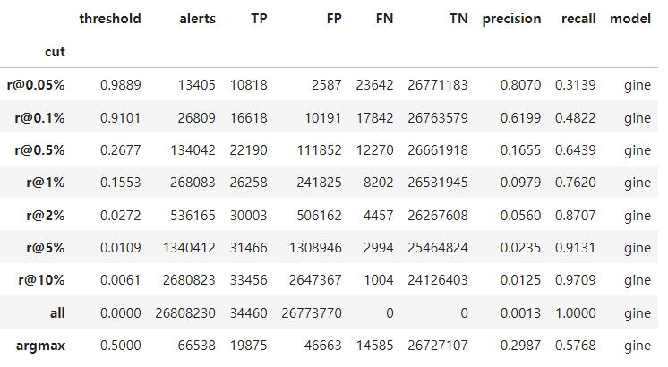

### 모델별 - 컷별 recall / precision
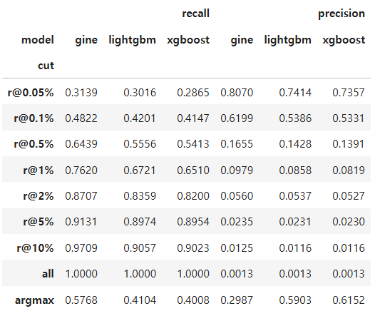

# PR 곡선
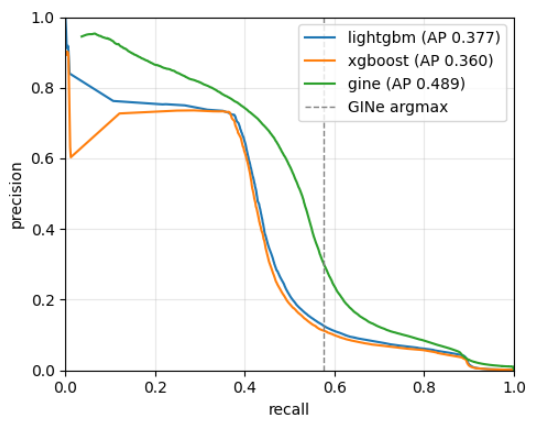

### 혼동행렬
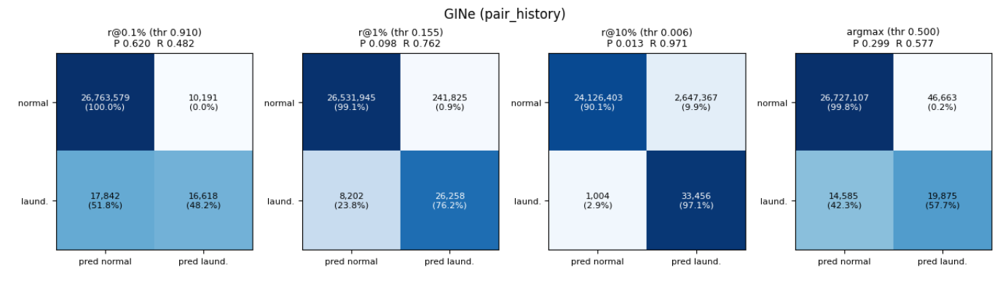

### 패턴별 recall
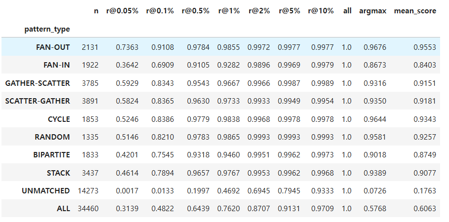

### 놓친 세탁(FN)
`pos_share`: 전체 양성 중 그 패턴의 비중 (기준선)

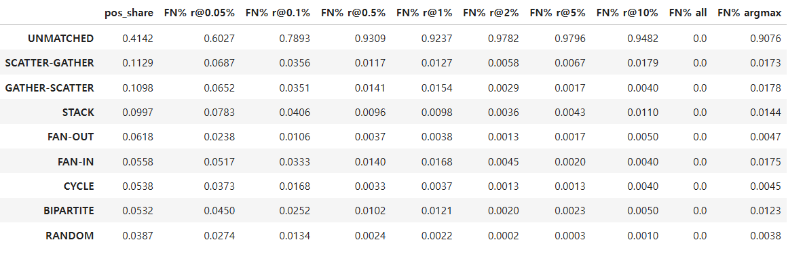

### 수신자 in-degree 층화
`n`: 그 구간에 속한 테스트 거래 전체 수 (정상 + 세탁). [100+]가 2,367만으로 전체의 88%
`n_pos`: 그중 세탁 거래 수. [100+] 16,860 = 양성의 절반
`pos_rate`: n_pos ÷ n = 그 구간의 세탁 비율. [10-19]가 0.86%로 제일 높고 [100+]는 0.07% - 허브로 들어가는 거래는 양으로는 세탁이 제일 많지만 비율로는 제일 희박해서, 거기서 찾는 게 어려운거임

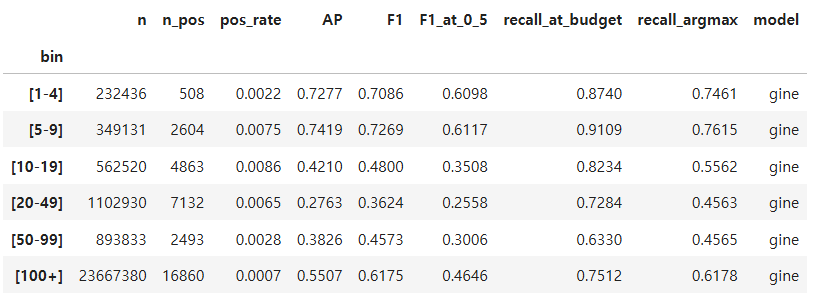

#### recall

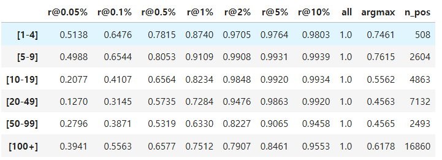

#### precision

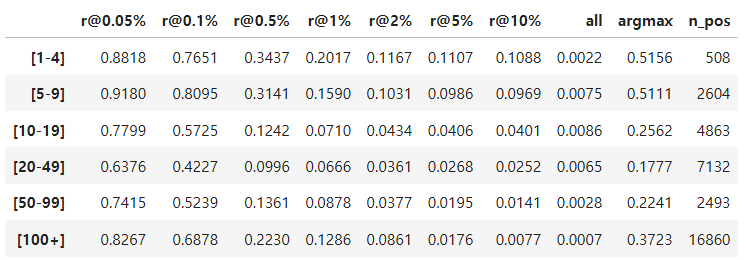

#### 잘못 잡은 정상(FP) 이 어느 차수 구간에 몰리나 
`neg_share` : 잘못 잡은 정상 거래를 모아 봤을 때 그 구간 비율

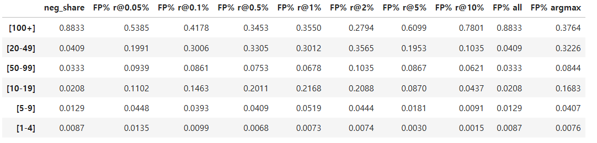

## 03_account_activity.ipynb 결과 (HI-Large, 기본 4 + pair 4 + 계좌 활동 8, 2026-10-31)

### 가설 vs 결과
- 가설: 한 계좌가 짧은 시간에 여러 상대와 거래하는 FAN-IN/OUT · GATHER-SCATTER · SCATTER-GATHER 가 빡빡한 컷에서 오르고, 02 에서 약했던 중간 차수 수신자 [20-49]·[50-99] AP 가 오른다
- 결과: **적중.** 0.1% 컷에서 FAN-IN 0.69 → 0.93, G-S 0.83 → 0.95, S-G 0.84 → 0.96. [10-19] 0.42 → 0.54, [20-49] 0.28 → 0.45. 전체 AP 0.49 → 0.55
- 예상 밖: UNMATCHED 가 내려감 (1% 0.47 → 0.43, argmax 0.073 → 0.013) — 모델이 패턴 탐지기로 특화. 트리가 0.36 → 0.525 로 GNN(0.549) 을 거의 따라잡음

### 설정
- 추가 피처 8: 
  - 송신 계좌의 최근 1h/24h 송금 건수(`src_out_1h`, `src_out_1d`)
  - 24h 상대 계좌 수(`src_uniq_dst_1d`, 일 단위 첫 거래 수로 근사)
  - 24h 송금액 합(`src_out_amt_1d`)
  - 수신 계좌 쪽 같은 4개(`dst_in_*`)
  전부 ln(1+x), 거래 시각 기준 과거만(같은 분 제외). GNN 18열, 트리 16열
- 모델·학습 설정은 02 와 동일. GINe best 60 에폭(92 에서 조기 종료, 11.9 시간) — 02 의 112 보다 빨리 수렴
- 트리: LightGBM best 352 라운드 26분, XGBoost 241 라운드 21분 (`max_delta_step=0.7` 적용 후 LightGBM 정상)

### 운영점 별 precision / recall - Gine
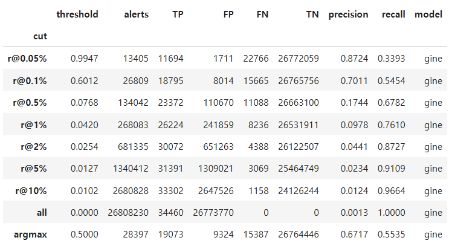

### 모델별 - 컷별 recall / precision
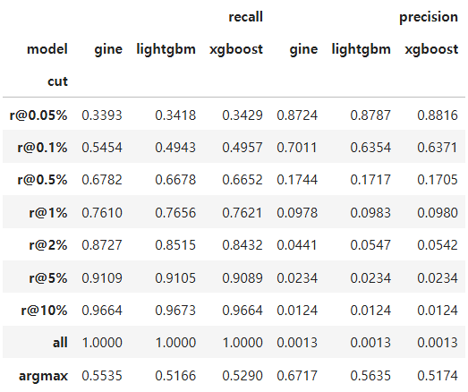

# PR 곡선
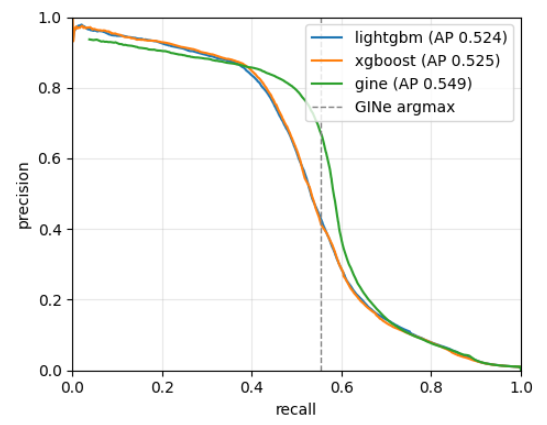

### 혼동행렬
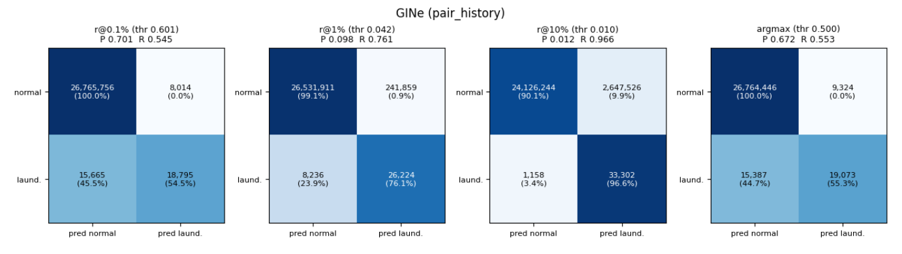

### 패턴별 recall

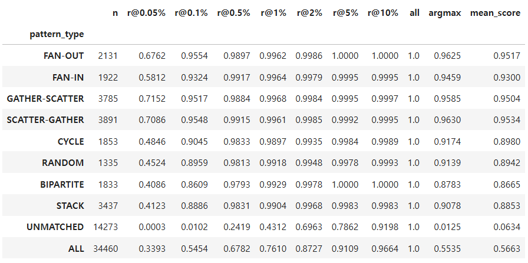

### 놓친 세탁(FN)
`pos_share`: 전체 양성 중 그 패턴의 비중 (기준선)

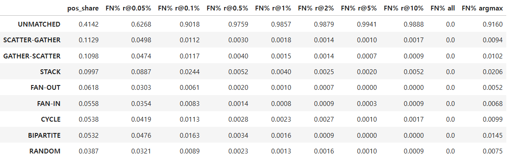

### 수신자 in-degree 층화
`n`: 그 구간에 속한 테스트 거래 전체 수 (정상 + 세탁). [100+]가 2,367만으로 전체의 88%
`n_pos`: 그중 세탁 거래 수. [100+] 16,860 = 양성의 절반
`pos_rate`: n_pos ÷ n = 그 구간의 세탁 비율. [10-19]가 0.86%로 제일 높고 [100+]는 0.07% - 허브로 들어가는 거래는 양으로는 세탁이 제일 많지만 비율로는 제일 희박해서, 거기서 찾는 게 어려운거임

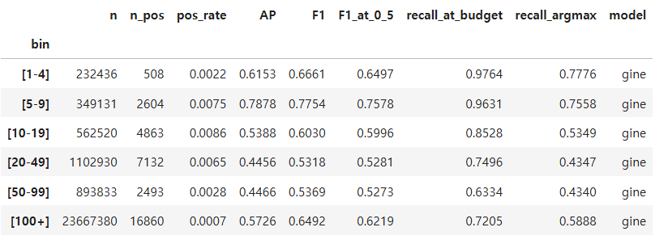

#### recall

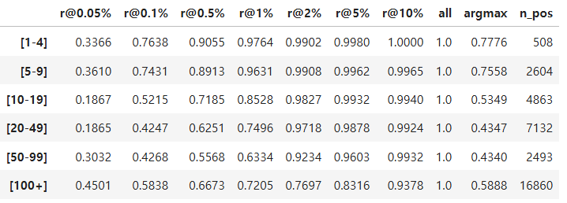

#### precision

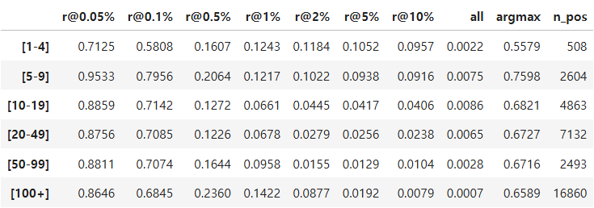

#### 잘못 잡은 정상(FP) 이 어느 차수 구간에 몰리나 
`neg_share` : 잘못 잡은 정상 거래를 모아 봤을 때 그 구간 비율

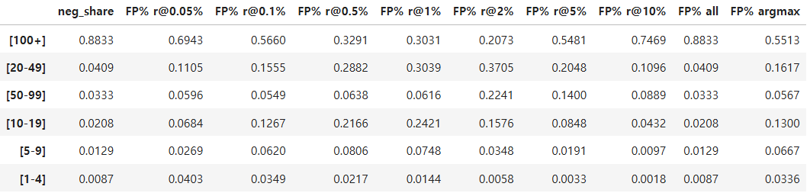

## 04_amount_stats 결과

### 설정
- 추가 피처 8 (전부 최근 24h, 거래 시각 기준 과거만, 같은 분 제외):
  - 송신 계좌가 최근 24h 에 보낸 금액의 평균 / 표준편차 / 최대 (`src_amt_mean_1d`, `src_amt_std_1d`, `src_amt_max_1d`)
  - 이번 금액이 그 평균의 몇 배인가 (`src_amt_ratio_1d` = ln(1+금액) − ln(1+평균), 이력 없으면 0)
  - 수신 계좌 쪽 같은 4개 (`dst_amt_*`)
  03 의 `*_amt_1d` 는 금액 합계(활동량), 04 는 분포(평소 금액 대비 이상치). GNN 26열, 트리 24열
- 모델·학습 설정은 03 과 동일. GINe best 68 에폭(100 에서 조기 종료, 10.6 시간). 검증 AP 가 0.28~0.54 로 크게 출렁임 — 입력이 늘면서 학습이 불안정
- 트리: LightGBM best 500 라운드(상한에 걸림, 다음엔 1000) 44분, XGBoost 320 라운드 31분. X_train(1억 × 24 float32 = 9.8GB) 을 만들지 않고 memmap 을 묶음으로 읽는 `train_trees_lowmem`(LightGBM Sequence / XGBoost DataIter) 으로 학습
- 테스트: 테스트 그래프(1.68억 × 2 간선) 가 anon 메모리를 24GB 까지 밀어 피처 memmap(9.3GB) 이 캐시에 못 들어가는 스래싱 발생(CPU 12%, GPU 0%, 13시간 정지) → 피처 행렬을 GPU float16 으로 올려(9.3GB) 배치 변환이 GPU 에서 `F[orig]` 를 뽑도록 바꿈. 추론 배치 8192 → 2048 (다른 프로세스가 GPU 11GB 점유)

### 가설 vs 결과
- 가설: 스머핑(작게 쪼개 반복 = STACK·BIPARTITE) 과 허브 구간 구별 (SALT C1: 평균 뒤에 숨는 이상치)
- 결과: **스머핑은 소폭 적중, 허브는 불발.** STACK argmax 0.91 → 0.94, BIPARTITE 0.88 → 0.93 (03 에서 내려간 걸 02 수준으로 복구). 허브 [20-49] 0.45 → 0.41, [50-99] 0.45 → 0.43 으로 오히려 하락 — 이상치 통계를 입력 피처로 넣는 것으로는 집계 안의 문제(C1) 가 안 풀린다는 SALT 주장과 일치. 전체 AP 0.549 → 0.535 (시드 노이즈 범위), 트리 +0.008 로 GNN 과 격차 0
- 판단: GNN 입력에서는 제외, 트리 참조 모델에는 유지. 05 는 03 피처 위에

### 운영점 별 precision / recall - Gine
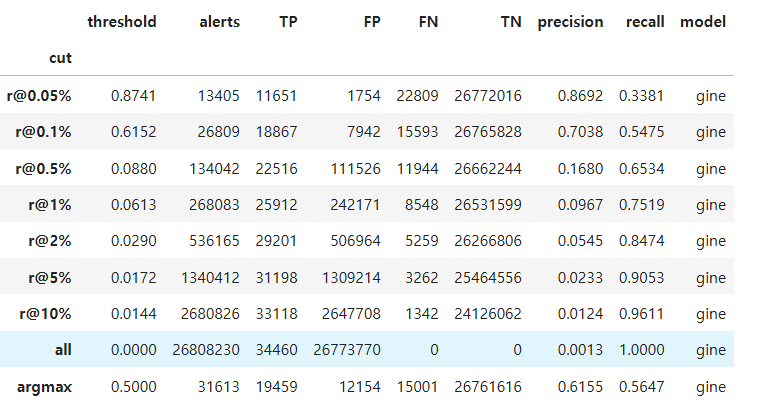

### 모델별 - 컷별 recall / precision
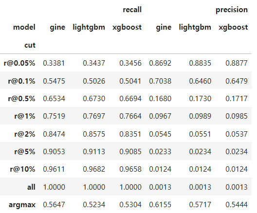

# PR 곡선
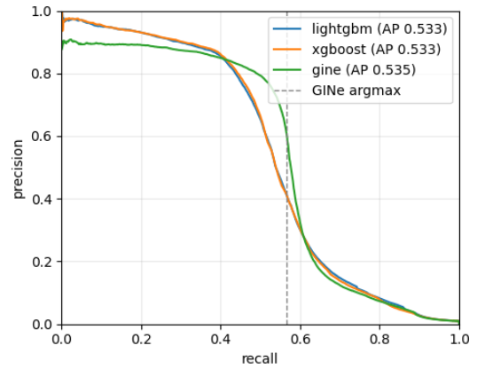

### 혼동행렬
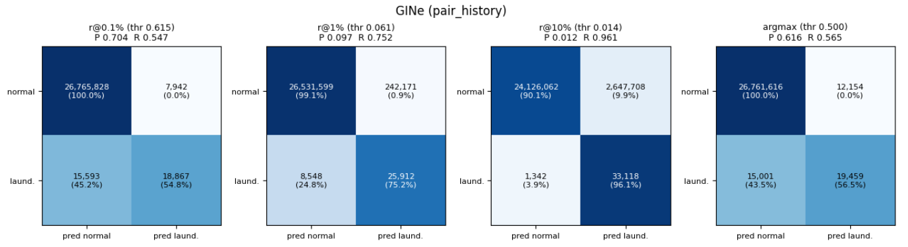

### 패턴별 recall

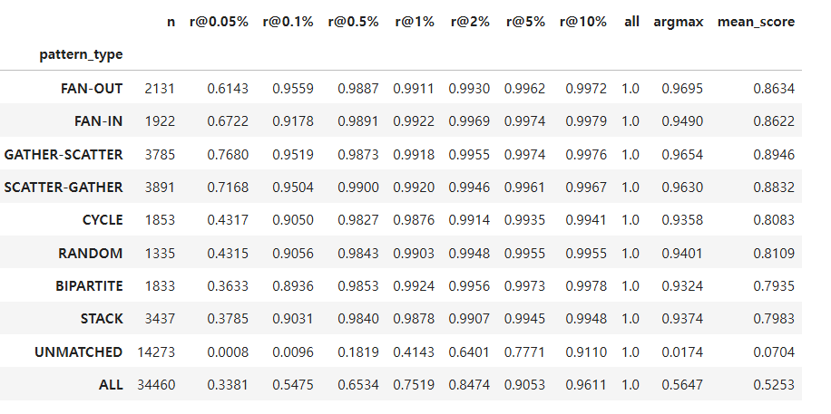

### 놓친 세탁(FN)
`pos_share`: 전체 양성 중 그 패턴의 비중 (기준선)

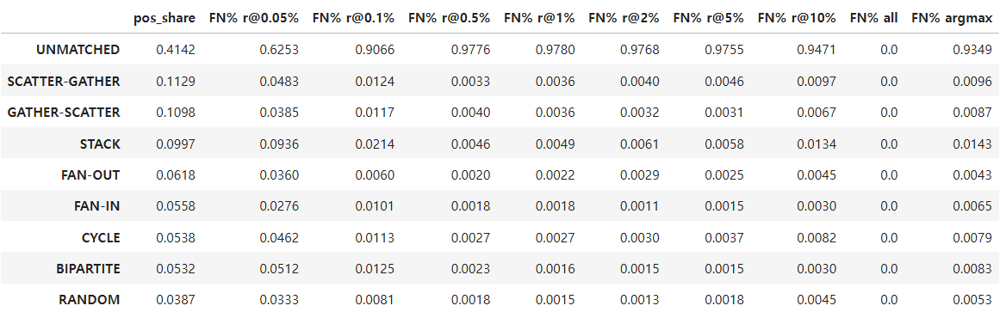

### 수신자 in-degree 층화
`n`: 그 구간에 속한 테스트 거래 전체 수 (정상 + 세탁). [100+]가 2,367만으로 전체의 88%
`n_pos`: 그중 세탁 거래 수. [100+] 16,860 = 양성의 절반
`pos_rate`: n_pos ÷ n = 그 구간의 세탁 비율. [10-19]가 0.86%로 제일 높고 [100+]는 0.07% - 허브로 들어가는 거래는 양으로는 세탁이 제일 많지만 비율로는 제일 희박해서, 거기서 찾는 게 어려운거임

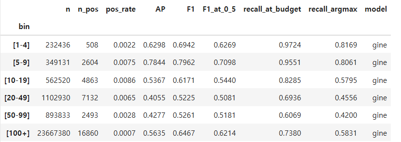

#### recall

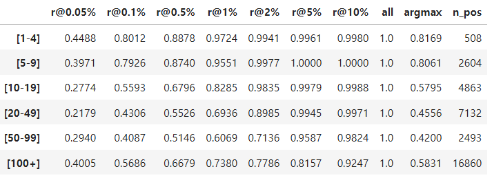

#### precision

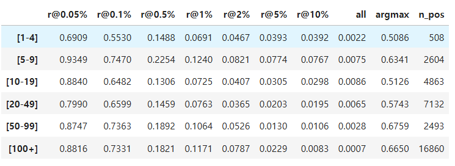

#### 잘못 잡은 정상(FP) 이 어느 차수 구간에 몰리나 
`neg_share` : 잘못 잡은 정상 거래를 모아 봤을 때 그 구간 비율

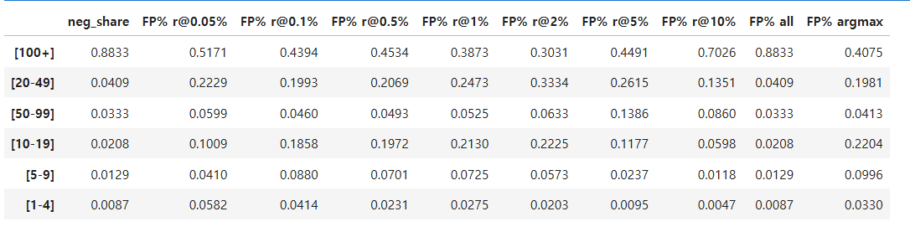

## 06_account_history 결과 (HI-Large, 03 + 계좌 이력·평소 대비 12, 2026-11-06)

### 설정
- 04(금액 분포)는 효과가 없어 제외하고 **03 위에** 쌓음. 추가 피처 12 (src / dst 양쪽 6 개씩):
  - `hist_out` / `hist_in`: 전날까지 누적 송금 / 수취 건수
  - `hist_uniq_out` / `hist_uniq_in`: 전날까지 누적 서로 다른 상대 수
  - `active_days`: 전날까지 활동한 날짜 수
  - `rate_vs_prior`: 최근 24h 건수 vs 과거 일평균 — ln(1+24h) − ln(1+누적/활동일), 이력 없으면 0
  - `minute_burst`: 같은 분 집중도 — ln(1+60·같은 분 건수) − ln(1+직전 60분 건수)
  - `gap_minutes`: 계좌의 직전 거래까지 log(2+분), 없으면 0
  - 전부 ln. 누적은 일 단위 ASOF(전날까지, `reverse_history` 와 같은 꼴), 창·간격은 거래 시각 기준 과거만. 예외는 `minute_burst` — 분 단위 데이터라 같은 분 안의 순서가 없어 같은 분 전체를 씀 (v10 과 동일)
  - v10 채택 41종 중 정상 vs 무패턴 분리도가 높았던 묶음(`log_out_count`, `day_ccy_rate_vs_prior`, `minute_sender_vs_prior_hour`, `sender_gap_minutes`) 을 우리 규칙으로 다시 정의한 것. `amount_seen`(과거 동일 금액 여부) 은 parquet 에 계산만 하고 **제외** (`USE_AMOUNT_SEEN=False`) — 데이터 생성 규칙 의존 의심, 별도 런으로
  - GNN 30열, 트리 28열
- 모델·학습 설정은 03 과 동일. GINe best 28 에폭(60 에서 조기 종료, **3.9 시간**) — 피처 행렬을 학습부터 GPU 에 올려(`store.features_to_gpu`) 에폭당 390초 → 233초, 수렴도 빠름
- 트리: LightGBM best 381 라운드 38분, XGBoost 437 라운드 41분 (`train_trees_lowmem`)
- 피처 생성: 일 단위 계좌 상태(ASOF) + 창 함수 2회. 처음엔 1.8억 행 테이블 넷을 한 번에 조인해 DuckDB 12GB 초과 → 한쪽(src/dst)씩 피처 테이블을 만든 뒤 둘만 조인하는 구조로 수정

### 가설 vs 결과
- 가설: 무패턴 세탁은 이력이 짧은 계좌·평소보다 갑자기 활발한 계좌에서 나온다 → UNMATCHED 가 오른다
- 결과: **적중.** UNMATCHED 1% 컷 0.431 → **0.510**, 0.5% 컷 0.242 → 0.367, argmax 0.013 → 0.048, 평균 점수 0.063 → 0.106. 02 이후 처음으로 recall@1% 천장(0.76) 이 0.795 로 올라감
- 반전: **트리가 GNN 을 넘어섬** — XGBoost 0.525 → 0.639 (+0.11), GINe 0.549 → 0.583 (+0.035). 격차 −0.056. 계좌 단위 표 피처는 트리가 훨씬 잘 쓴다

## 전체 (테스트, 03 → 06)

| | AP | F1 | F1@0.5 | recall@1% | unmatched@1% |
|---|---|---|---|---|---|
| 03 GINe | 0.549 | 0.619 | 0.607 | 0.761 | 0.431 |
| **06 GINe** | **0.583** | 0.643 | 0.643 | 0.795 | **0.510** |
| 06 XGBoost | **0.639** | **0.677** | 0.651 | 0.811 | 0.544 |
| 06 LightGBM | 0.634 | 0.672 | 0.638 | 0.813 | 0.549 |

- argmax 운영점: FP 9,324 → 6,038, precision 0.672 → 0.761, recall 0.554 → 0.557 — 오탐이 1/3 줄고 탐지는 유지
- 검증 AP 도 GINe 0.561 → 0.588 로 올라 03 보다 높음 (04 는 0.542 로 낮았음)

## 패턴별 recall (GINe, 03 → 06)

| 패턴 | n | r@0.1% | r@0.5% | r@1% | argmax |
|---|---|---|---|---|---|
| FAN-OUT | 2,131 | 0.955 → 0.956 | 0.990 → 0.990 | 0.996 → 0.998 | 0.963 → 0.947 |
| FAN-IN | 1,922 | 0.932 → 0.931 | 0.992 → 0.978 | 0.996 → 0.996 | 0.946 → 0.912 |
| GATHER-SCATTER | 3,785 | 0.952 → 0.947 | 0.988 → 0.985 | 0.997 → 0.998 | 0.959 → 0.936 |
| SCATTER-GATHER | 3,891 | 0.955 → 0.951 | 0.992 → 0.989 | 0.996 → 0.999 | 0.963 → 0.938 |
| CYCLE | 1,853 | 0.905 → 0.930 | 0.983 → 0.988 | 0.990 → 0.998 | 0.917 → 0.915 |
| RANDOM | 1,335 | 0.896 → 0.921 | 0.981 → 0.979 | 0.992 → 0.997 | 0.914 → 0.908 |
| BIPARTITE | 1,833 | 0.861 → 0.881 | 0.979 → 0.972 | 0.993 → 0.996 | 0.878 → 0.861 |
| STACK | 3,437 | 0.889 → 0.909 | 0.983 → 0.980 | 0.990 → 0.996 | 0.908 → 0.888 |
| **UNMATCHED** | 14,273 | 0.010 → 0.055 | 0.242 → **0.367** | 0.431 → **0.510** | 0.013 → **0.048** |
| ALL | 34,460 | 0.545 → 0.569 | 0.678 → 0.728 | 0.761 → 0.795 | 0.554 → 0.557 |

- 매칭 패턴은 1% 컷에서 전부 ≥ 0.996 유지. 0.1% 컷에서는 CYCLE·RANDOM·BIPARTITE·STACK 이 +2~3pt (03 에서 fan 계열에 치우쳤던 걸 되돌림)
- argmax 에서 매칭 패턴이 1~3pt 내려간 건 점수 질량이 UNMATCHED 쪽으로 옮겨간 효과 — 같은 임계값에서 알림 수가 28,397 → 25,229 로 줄면서 FP 가 더 크게 빠짐

## 수신자 in-degree 별 AP (GINe, 03 → 06)

| bin | n_pos | AP | F1 |
|---|---|---|---|
| [1-4] | 508 | 0.615 → 0.565 | 0.666 → 0.662 |
| [5-9] | 2,604 | 0.788 → 0.790 | 0.775 → 0.795 |
| [10-19] | 4,863 | 0.539 → **0.576** | 0.603 → 0.638 |
| [20-49] | 7,132 | 0.446 → **0.481** | 0.532 → 0.544 |
| [50-99] | 2,493 | 0.447 → 0.460 | 0.537 → 0.533 |
| [100+] | 16,860 | 0.573 → **0.608** | 0.649 → 0.674 |

- [10-19] 이상 전 구간 상승. [1-4] 하락은 n=508 노이즈 범위

### 읽히는 것
1. 02 이후 가장 큰 상승이고, 처음으로 UNMATCHED 를 건드린 피처 묶음. "이력의 길이·평소 대비 변화" 가 패턴 피처와 다른 축의 정보라는 뜻
2. 트리 0.639 > GINe 0.583. 1단계 결론이 "시간창·이력 피처가 있으면 트리 ≥ GINe" 로 기움. 2단계의 질문은 "어느 GNN 이 좋나" 가 아니라 **"GNN 이 트리에 뭘 더해 주나"** (어텐션·SALT 가 격차를 뒤집는지, GNN 임베딩 + 트리 결합이 더 나은지)
3. GNN 이 이 피처를 트리만큼 못 쓰는 건 03·04 와 같은 이유 — 표 피처는 분할점을 잡는 트리가 유리하고, GINe 는 선형층으로 섞어 약한 신호가 묻힘
4. 다음: `USE_AMOUNT_SEEN=True` 런 (v10 최강 무패턴 신호, 일반화 위험 분리) → 05 GFP (모티프 피처까지 받은 트리가 어디까지 가나)

## 지금까지 전체 요약

## 1단계 피처 사다리 요약 (HI-Large, 테스트 구간 전체, GINe 고정)

| 단계 | 피처 (GNN 열 수) | GINe AP | GINe F1 | recall@1% | unmatched@1% | XGBoost AP | LightGBM AP | GNN−트리 | best 에폭 / 학습 시간 |
|---|---|---|---|---|---|---|---|---|---|
| 01 basic | 기본 4 + port 2 (6) | 0.393 | 0.472 | 0.745 | 0.432 | 0.051 | 0.046* | +0.34 | 108 / 10.7h |
| 02 +pair | + 같은 쌍 반복 4 (10) | 0.489 | 0.545 | 0.762 | 0.469 | 0.360 | 0.377 | +0.11 | 112 / 16.2h |
| 03 +활동 | + 계좌 단기 활동 8 (18) | 0.549 | 0.619 | 0.761 | 0.431 | 0.525 | 0.524 | +0.02 | 60 / 11.9h |
| 04 +금액분포 | + 계좌 금액 분포 8 (26) | 0.535 | 0.621 | 0.752 | 0.414 | 0.533 | 0.533 | 0.00 | 68 / 10.6h |
| 06 +이력 (03 위에) | + 계좌 이력·평소 대비 12 (30) | **0.583** | **0.643** | **0.795** | **0.510** | **0.639** | **0.634** | **−0.056** | 28 / 3.9h |

\* 01 LightGBM 은 잎 값 폭주(best_iteration 1) 상태의 수치 — 02 부터 `max_delta_step` 적용

### 수신 계좌 in-degree 구간별 AP (GINe)

| 단계 | [1-4] | [5-9] | [10-19] | [20-49] | [50-99] | [100+] |
|---|---|---|---|---|---|---|
| 01 | 0.750 | 0.726 | 0.391 | 0.272 | 0.288 | 0.388 |
| 02 | 0.728 | 0.742 | 0.421 | 0.276 | 0.383 | 0.551 |
| 03 | 0.615 | 0.788 | **0.539** | **0.446** | **0.447** | **0.573** |
| 04 | 0.630 | 0.784 | 0.537 | 0.406 | 0.428 | 0.564 |
| 06 | 0.565 | 0.790 | **0.576** | **0.481** | **0.460** | **0.608** |

### 패턴별 recall (GINe) — 1% 예산 컷

| 패턴 | n | 01 | 02 | 03 | 04 | 06 |
| --- | --- | --- | --- | --- | --- | --- |
| FAN-OUT | 2,131 | 0.984 | 0.986 | 0.996 | 0.991 | 0.998 |
| FAN-IN | 1,922 | 0.949 | 0.928 | 0.996 | 0.992 | 0.996 |
| GATHER-SCATTER | 3,785 | 0.961 | 0.967 | 0.997 | 0.992 | 0.998 |
| SCATTER-GATHER | 3,891 | 0.976 | 0.973 | 0.996 | 0.992 | 0.999 |
| CYCLE | 1,853 | 0.967 | 0.984 | 0.990 | 0.988 | 0.998 |
| RANDOM | 1,335 | 0.965 | 0.987 | 0.992 | 0.990 | 0.997 |
| BIPARTITE | 1,833 | 0.953 | 0.946 | 0.993 | 0.992 | 0.996 |
| STACK | 3,437 | 0.963 | 0.977 | 0.990 | 0.988 | 0.996 |
| **UNMATCHED** | 14,273 | 0.432 | **0.469** | 0.431 | 0.414 | **0.510** |
| ALL | 34,460 | 0.745 | 0.762 | 0.761 | 0.752 | 0.795 |

### 패턴별 recall (GINe) — 0.1% 예산 컷 (알림 2.7만 건 ≈ argmax 운영점 규모)

| 패턴 | 02 | 03 | 04 |
|---|---|---|---|
| FAN-OUT | 0.911 | 0.955 | 0.956 |
| FAN-IN | 0.691 | **0.932** | 0.918 |
| GATHER-SCATTER | 0.834 | **0.952** | 0.952 |
| SCATTER-GATHER | 0.837 | **0.955** | 0.950 |
| CYCLE | 0.839 | 0.905 | 0.905 |
| RANDOM | 0.821 | 0.896 | 0.906 |
| BIPARTITE | 0.755 | 0.861 | 0.894 |
| STACK | 0.789 | 0.889 | 0.903 |
| UNMATCHED | 0.013 | 0.010 | 0.010 |
| ALL | 0.482 | 0.545 | 0.548 |

### 패턴별 recall (GINe) — argmax (확률 0.5, 논문 F1 운영점)

| 패턴 | 02 | 03 | 04 |
|---|---|---|---|
| FAN-OUT | 0.968 | 0.963 | 0.970 |
| FAN-IN | 0.867 | 0.946 | 0.949 |
| GATHER-SCATTER | 0.932 | 0.959 | 0.965 |
| SCATTER-GATHER | 0.935 | 0.963 | 0.963 |
| CYCLE | 0.964 | 0.917 | 0.936 |
| RANDOM | 0.958 | 0.914 | 0.940 |
| BIPARTITE | 0.902 | 0.878 | 0.932 |
| STACK | 0.939 | 0.908 | 0.937 |
| **UNMATCHED** | **0.073** | 0.013 | 0.017 |
| ALL | 0.577 | 0.554 | 0.565 |
