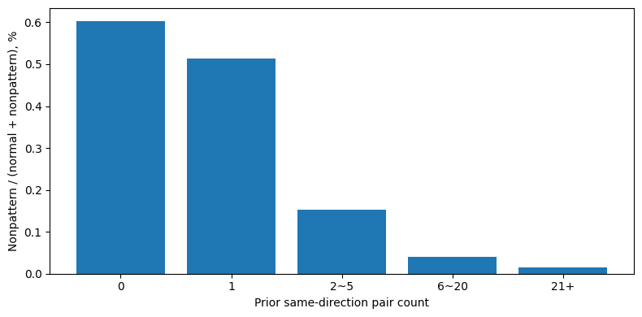
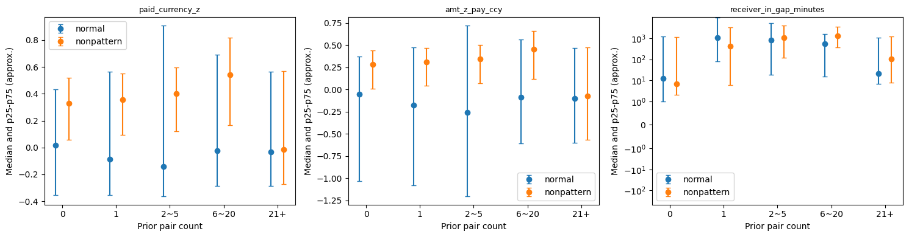
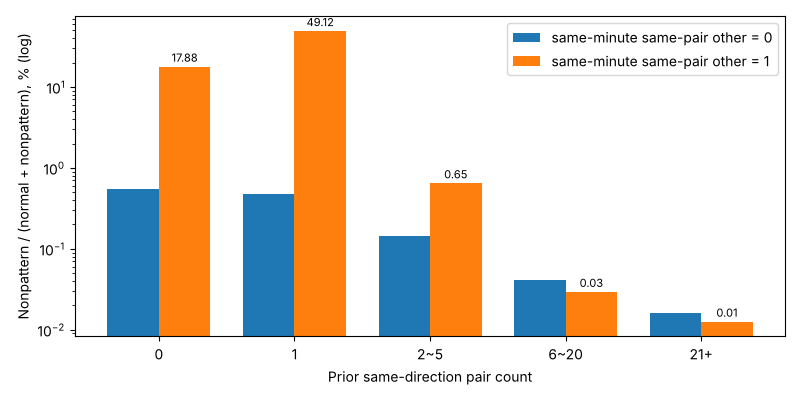
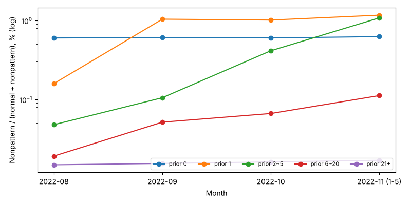

# 03. 과거 거래 5개 구간과 같은 분 활동 — 정상 vs 무패턴

노트북: [`03_pair_bins_same_minute_analysis.ipynb`](../../code/nonpaten_vs_normal/03_pair_bins_same_minute_analysis.ipynb) · 이전: [02](02_pair_history_amount_receiver_analysis.md) · 다음: [04](04_upstream_same_minute_diagnosis.md)

## 1. 분석 범위

03번 노트북의 저장 결과다. 02번의 과거 이력·금액 z·입금 간격을 **그대로 재사용**하고, 같은 분 활동 4개만 새로 계산했다.

| 항목 | 기준 |
|---|---|
| 비교 기간 | 2022-08-08 이상 ~ 2022-11-06 미만. 정상·무패턴 모두 11월 1~5일까지 (02는 정상에 12~1월 관측분이 포함돼 있었음) |
| 건수 | 정상 **164,534,286건**, 무패턴 **82,199건** |
| 과거 이력 구간 | `pair_prior_n` 원래 건수 기준 **0 / 1 / 2~5 / 6~20 / 21건 이상** |
| 같은 분 활동 | 그 분이 끝난 뒤 알 수 있는 정보. 패턴 거래도 포함해 세고, 현재 거래 자신은 뺀다. 같은 분 안의 순서는 추정하지 않는다 |
| 무패턴 비율 | 무패턴 / (정상 + 무패턴). 패턴 양성은 분모에 없다 |

| 같은 분 피처 | 현재 거래 A → B 기준 정의 |
|---|---|
| `pair_same_minute_other_n` | 같은 분 A → B의 다른 거래 수 |
| `receiver_same_minute_other_in_n` | 같은 분 B가 받은 다른 입금 수 |
| `receiver_same_minute_other_in_neighbors` | 현재 거래를 뺀 같은 분 입금의 고유 송신 계좌 수 |
| `receiver_same_minute_other_out_n` | 같은 분 B가 보낸 출금 수 (현재 거래가 B → B일 때만 자신을 뺌) |

## 2. 반복 거래를 나누면 1건 구간까지 무패턴 비율이 높다

| 과거 동일 방향 쌍 거래 | 정상 | 무패턴 | 무패턴 비율 | 정상 중 비중 | 무패턴 중 비중 |
|---|---:|---:|---:|---:|---:|
| 0 | 4,480,226 | 27,207 | **0.604%** | 2.72% | **33.10%** |
| 1 | 2,699,649 | 13,961 | **0.514%** | 1.64% | **16.98%** |
| 2~5 | 8,684,809 | 13,344 | 0.153% | 5.28% | 16.23% |
| 6~20 | 17,043,003 | 6,990 | 0.041% | 10.36% | 8.50% |
| 21+ | 131,626,599 | 20,697 | 0.016% | 80.00% | 25.18% |

[02](02_pair_history_amount_receiver_analysis.md)에서 `one_or_more`로 묶었던 반복 거래 안에서도 **1건 구간(0.514%)은 0건 구간(0.604%)과 비슷한 수준**이다. 과거 건수가 늘수록 비율이 단조롭게 내려간다. 다만 21건 이상에도 무패턴의 **25.18%**가 있어, 과거 건수가 많다는 이유로 정상 처리하면 무패턴 4건 중 1건을 놓친다.

## 3. 금액 z는 20건 이하 구간에서만 차이가 크다

아래는 중앙값이다. 점과 선은 중앙값과 25~75백분위이며 신뢰구간이 아니다.

| 구간 | `paid_currency_z` 정상 | 무패턴 | 수신 누적 입금 정상 | 무패턴 | 직전 입금 후 분 정상 | 무패턴 |
|---|---:|---:|---:|---:|---:|---:|
| 0 | 0.015 | **0.328** | 23 | 13 | 12 | 7 |
| 1 | −0.086 | **0.357** | 23 | 23 | 1,048 | 425 |
| 2~5 | −0.140 | **0.402** | 34 | 28 | 792 | 1,046 |
| 6~20 | −0.025 | **0.541** | 31 | 27 | 560 | 1,278 |
| 21+ | −0.033 | −0.013 | 137 | 129 | **21** | **106** |

- 0~20건 구간에서 무패턴의 금액 z 중앙값이 정상보다 **0.31~0.57** 높다. 21건 이상에서는 차이가 거의 없다.
- 직전 입금 후 경과 시간은 구간마다 방향이 바뀐다(0·1건은 무패턴이 짧고, 2~20건은 길다). 단일 규칙으로 쓰기 어렵다.
- 분포의 25~75백분위가 크게 겹친다. 금액 z 하나로 임계값을 정할 수준은 아니다.

## 4. 같은 분 같은 쌍 거래가 있으면 0·1건 구간의 무패턴 비율이 크게 오른다

| 과거 쌍 거래 | 같은 분 같은 쌍 다른 거래 0건: 정상 / 무패턴 / 비율 | 1건: 정상 / 무패턴 / 비율 |
|---|---|---|
| 0 | 4,467,952 / 24,534 / 0.546% | 12,274 / 2,673 / **17.88%** |
| 1 | 2,698,409 / 12,764 / 0.471% | 1,240 / 1,197 / **49.12%** |
| 2~5 | 8,545,024 / 12,442 / 0.145% | 138,579 / 902 / 0.647% |
| 6~20 | 16,582,463 / 6,856 / 0.041% | 455,321 / 134 / 0.029% |
| 21+ | 125,259,484 / 19,901 / 0.016% | 6,258,680 / 789 / 0.013% |

처음(0건) 또는 두 번째(1건) 거래인 쌍이 **같은 분에 한 번 더 보내면** 무패턴 비율이 17.9%·49.1%로 오른다. 기준선 0.05% 대비 수백 배다. 6건 이상 반복 쌍에서는 같은 분 거래가 있어도 오르지 않는다. 같은 분 2건 이상(2~5)인 칸에는 무패턴이 거의 없다.

해당 무패턴은 0건 2,673건 + 1건 1,197건 = **3,870건(무패턴의 4.7%)**이다. 범위는 작지만 순도가 높아, [04](04_upstream_same_minute_diagnosis.md) 4~5절에서 이 칸을 다시 확인했다.

## 5. 수신 계좌의 같은 분 활동은 보조 신호다

| 과거 쌍 거래 | 같은 분 수신 계좌 다른 입금 0건 → 1건 | 같은 분 수신 계좌 출금 0건 → 1건 |
|---|---|---|
| 0 | 0.596% → 0.773% | 0.609% → **0.030%** |
| 1 | 0.461% → **1.584%** | 0.522% → **0.021%** |
| 2~5 | 0.144% → 0.474% | 0.157% → 0.004% |

- 같은 분 다른 입금이 있으면 1건 구간에서 비율이 약 3.4배 오르지만, 0건 구간에서는 1.3배다.
- **받은 계좌가 같은 분에 다시 보내면 무패턴이 거의 없다.** 과거 0~5건 구간에서 출금 1건 칸의 무패턴 비율은 0.004~0.030%로, 출금 0건 칸의 1/20 이하다.
- 고유 송신 계좌 수(`other_in_neighbors`)는 다른 입금 수와 거의 같은 결과다.

## 6. 월별로 반복 구간의 무패턴 비율이 크게 오른다

| 월 | 0건 | 1건 | 2~5 | 6~20 | 21+ |
|---|---:|---:|---:|---:|---:|
| 2022-08 (8~31일) | 0.600% | 0.159% | 0.048% | 0.019% | 0.015% |
| 2022-09 | 0.608% | **1.037%** | 0.105% | 0.052% | 0.016% |
| 2022-10 | 0.601% | **1.011%** | 0.413% | 0.066% | 0.016% |
| 2022-11 (1~5일) | 0.624% | **1.166%** | **1.078%** | 0.112% | 0.017% |

0건과 21건 이상은 월별로 거의 일정하지만, **1건·2~5건 구간은 8월 대비 7~22배**가 된다. 이력을 8월 1일부터 누적하기 때문에 8월에는 정상 반복 쌍도 과거 건수가 작게 잡혀 1~5건 구간에 섞이고, 시간이 지나면 정상 반복 쌍은 21건 이상으로 빠져나간다. **누적 과거 건수의 같은 값이 기간마다 다른 의미**가 된다는 뜻이다. 학습과 평가 기간이 다르면 이 피처의 임계값이 그대로 옮겨지지 않는다.
