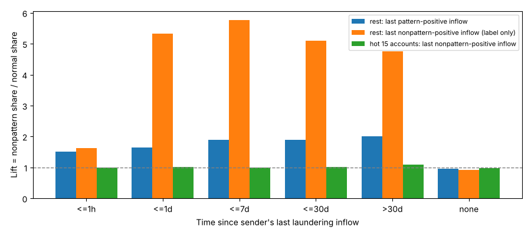
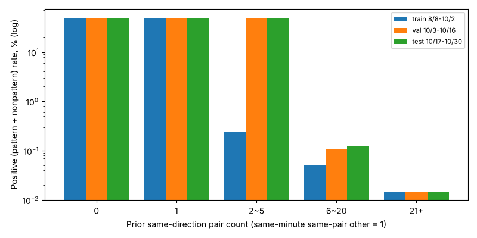
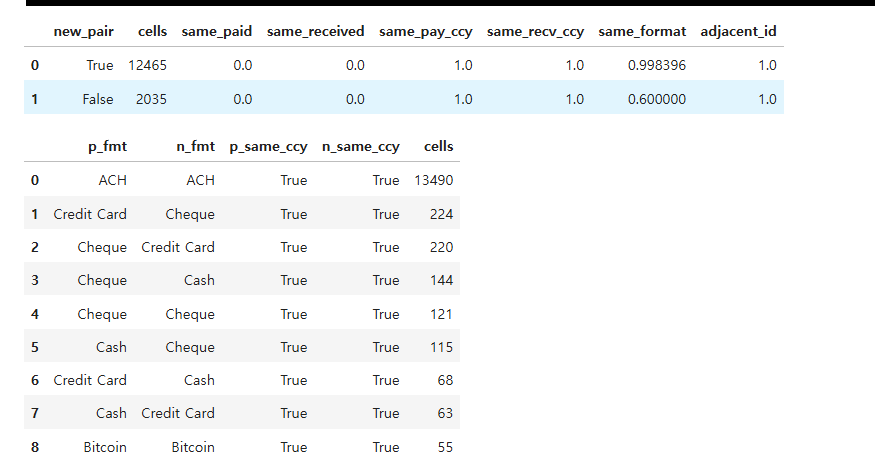
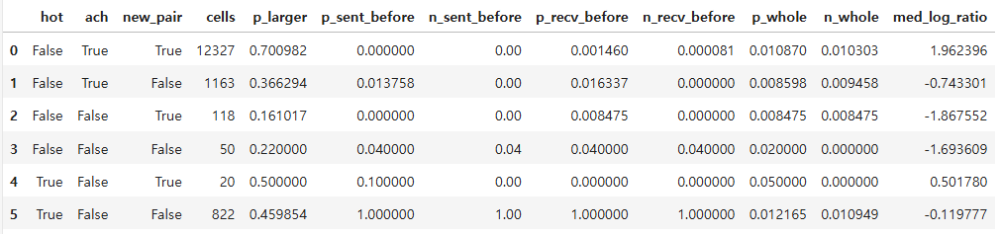

# 04. 돈의 출처(상류)와 같은 분 같은 쌍 쌍둥이 — 정상 vs 무패턴

노트북: [`04_upstream_same_minute_diagnosis.ipynb`](../../code/nonpaten_vs_normal/04_upstream_same_minute_diagnosis.ipynb) · 이전: [03](03_pair_bins_same_minute_analysis.md)

## 1. 분석 범위

04번 노트북의 저장 결과다. [03](03_pair_bins_same_minute_analysis.md)과 달리 **패턴 양성도 집계에 넣었다**(이진 모델의 운영점에서는 패턴 양성도 양성이므로). 분할은 binary_classification 실험과 같다.

| 구간 | 정상 | 패턴 | 무패턴 | 무패턴 비율 |
|---|---:|---:|---:|---:|
| (이력만) 8/1~8/7, 10/31 | 14,925,801 | 1,795 | 5,411 | 0.036% |
| Train 8/8~10/2 | 102,225,958 | 62,889 | 47,782 | 0.047% |
| Val 10/3~10/16 | 24,379,251 | 20,100 | 13,695 | 0.056% |
| Test 10/17~10/30 | 26,773,770 | 20,187 | 14,273 | 0.053% |

- 분할별 거래 수는 binary_classification 실험과 같다(102,336,629 / 24,413,046 / 26,808,230).
- 이력 기간(8/1~10/30) 무패턴은 81,161건이다. 팀원 무패턴 분석 문서(8/1~10/31)는 82,260건이며, 10/31 하루가 빠진 차이로 보인다.
- 같은 분은 과거로 세지 않는다. 상류 입금도 **거래 시각보다 이전 분**만 본다.

## 2. 무패턴의 28%는 은행 70의 송신 계좌 15개에서 나온다

| 송신 계좌당 무패턴 건수 | 송신 계좌 수 | 무패턴 | 같은 계좌의 정상 |
|---|---:|---:|---:|
| 1 | 42,798 | 42,798 | 2,735,664 |
| 2~9 | 6,954 | 15,677 | 463,250 |
| 100~999 | 11 | 6,571 | 4,666,183 |
| 1000+ | 4 | 16,115 | 11,334,325 |

10~99건 송신 계좌는 없다. 100건 이상인 **15개 계좌(이하 hot)**는 전부 은행 70(National Bank of Indianapolis)이고 소유주도 15명 모두 다르다. 이 계좌들이 무패턴 **22,686건**을 보냈고, 같은 기간 정상도 **1,600만 건**을 보냈다. 팀원 분석의 "은행 70 송신 계좌 15개, 22,979건"과 같은 집단이다.

hot 계좌의 정상 대비 무패턴 비율은 **0.141%**이다. 이후 모든 구간에서 이 값이 거의 변하지 않았다.

## 3. 상류 출처 — 접는다

송신 계좌가 이 거래 전에 마지막으로 세탁 입금(패턴 양성 / 무패턴 양성)을 받은 뒤 지난 시간을 6개 구간으로 나눴다. 배수 = 그 구간의 무패턴 비중 / 정상 비중이다.

| 직전 세탁 입금 후 | hot: 무패턴 입금 기준 배수 | 나머지: 패턴 입금 기준 배수 · 무패턴 비율 | 나머지: 무패턴 입금 기준 배수 · 무패턴 비율 |
|---|---:|---:|---:|
| ≤1시간 | 1.00 | 1.50 · 0.059% | 1.62 · 0.064% |
| ≤1일 | 1.01 | 1.64 · 0.065% | 5.32 · 0.210% |
| ≤7일 | 0.99 | 1.89 · 0.075% | 5.76 · 0.227% |
| ≤30일 | 1.02 | 1.90 · 0.075% | 5.10 · 0.202% |
| >30일 | 1.09 | 2.00 · 0.079% | 4.76 · 0.188% |
| 없음 | 0.99 | 0.97 · 0.038% | 0.91 · 0.036% |

- **hot 15개 계좌는 패턴 양성 입금을 한 번도 받지 않았다.** 받은 무패턴 입금도 계좌당 0~7건이고, 모든 구간에서 배수 ≈ 1.0이다.
- 나머지 계좌의 패턴 입금 기준 배수는 1.5~2.0, 무패턴 비율은 최대 0.08%다. 피처로 쓸 수 있는 쪽(패턴은 1단계 모델이 거의 다 잡으므로 점수로 대체 가능)의 신호가 약하다.
- 무패턴 입금 기준 배수는 약 5지만 순도 0.2%, 해당 무패턴 11%이고, 라벨이 있어야 계산된다.

## 4. 같은 분 같은 쌍 칸의 양성 비율은 정확히 50%다

같은 분 같은 쌍 다른 거래가 **1건**인 칸([03](03_pair_bins_same_minute_analysis.md) 4절의 17.9%·49.1% 칸)에 패턴 양성도 넣어 보면:

| 과거 쌍 거래 | 정상 | 패턴 | 무패턴 | 무패턴 비율(패턴 제외) | **양성 비율** |
|---|---:|---:|---:|---:|---:|
| 0 | 11,270 | 8,852 | 2,416 | 17.65% | **49.996%** |
| 1 | 1,080 | 40 | 1,040 | 49.06% | **50.000%** |

같은 분 2건 칸이 거의 전부 **양성 1건 + 정상 1건**으로 이루어져 있다. 이 칸만으로 만든 규칙은 P 50%, 무패턴 R 4.56%(3,456건)에서 멈춘다.

과거 2~5건 칸은 val·test에서도 약 50%인데 train에서는 0.24%다. [03](03_pair_bins_same_minute_analysis.md) 6절과 같은 이유로 train 초반에는 정상 반복 쌍도 과거 건수가 작게 잡히기 때문이다.

## 5. 쌍둥이 두 거래는 금액만 다르고, 양성 쪽이 큰 경우가 70%다

양성 1 + 정상 1 칸에서 두 거래를 비교했다.

- **금액은 항상 다르다**(same_paid 0.0). 원본에 라벨만 다른 중복이 있는 것은 아니다.
- 통화는 항상 같고, 새 쌍(과거 0~1건)이면 결제방식도 99.8% 같다. 대부분 **ACH–ACH**(13,490칸)다.
- `adjacent_id = 1.0`은 의미 없다. 01 전처리의 `edge_id`가 시각·계좌 순으로 매겨져 같은 분·같은 쌍 거래는 원래 번호가 붙어 있다.

| 집단 | 칸 수 | 양성 쪽 금액이 큼 | 양성·정상의 금액을 전에 보낸 적 | 금액 비 중앙값 |
|---|---:|---:|---|---:|
| hot 밖 · ACH · 새 쌍 | 12,327 | **70.1%** | 0.0% / 0.0% | **e^1.96 ≈ 7배** |
| hot 밖 · ACH · 기존 쌍 | 1,163 | 36.6% | 1.4% / 0.0% | 0.48배 |
| hot · 기존 쌍 | 822 | 46.0% | 100% / 100% | 0.89배 |

- 핵심 칸(hot 밖·ACH·새 쌍)에서 두 거래 모두 **처음 보는 금액**이다. 송신자 단위 피처(`prior_ccy_amount_seen`, `minute_sender_vs_prior_hour` 등)는 쌍둥이 둘에 같은 값을 준다.
- 둘을 가르는 단서는 **같은 분 같은 쌍 다른 거래와 비교한 금액 크기**다. "큰 쪽" 규칙만으로 이 칸에서 P 약 70%다.
- 칸에 패턴 양성도 섞여 있어 무패턴만의 비율은 06 평가에서 따로 확인한다.
- "새 쌍이 같은 분에 2건, 큰 쪽이 세탁"은 실제 행동보다 **데이터 생성기의 특징**일 가능성이 크다. HI-Large 성능에는 유효하지만 다른 데이터로 일반화된다고 볼 수 없다.

## 6. 상류 입금과 같은 분 쌍은 거의 겹치지 않는다

무패턴을 "직전 7일 안에 패턴 양성 입금" × "같은 분 같은 쌍 1건 이상"으로 나눴다(분할 합계).

| 직전 7일 패턴 입금 | 같은 분 같은 쌍 | hot 무패턴 비중 | 나머지 무패턴 비중 | 나머지 무패턴 비율 |
|---|---|---:|---:|---:|
| 없음 | 없음 | 96.23% | 91.03% | 0.038% |
| 없음 | 있음 | 3.77% | **7.44%** | 0.070% |
| 있음 | 없음 | — | 1.17% | 0.058% |
| 있음 | 있음 | — | 0.37% | **0.335%** |

hot 집단은 같은 분 같은 쌍 칸에서도 무패턴 비율이 0.135%로 기준(0.141%)과 같다. 나머지 집단에서 같은 분 같은 쌍 칸이 무패턴의 7.8%를 차지한다.
