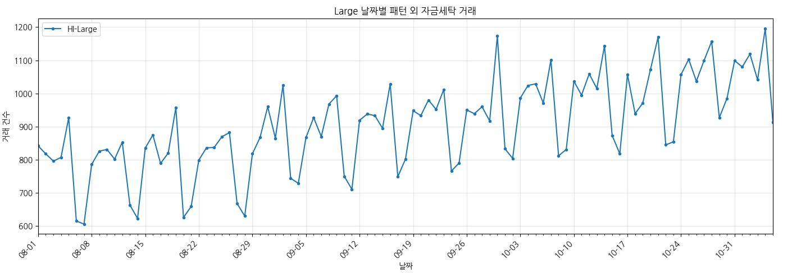
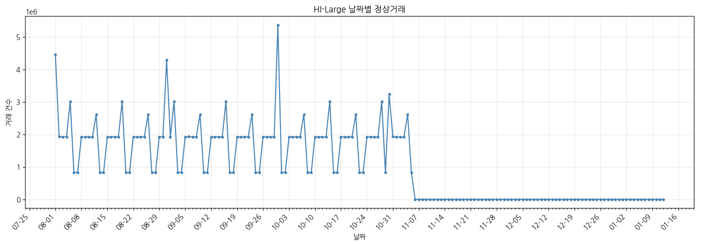

### 구간별 정상 · 패턴 · 무패턴 거래 수

완전 중복 150건 제거 후 기준. 출처: 01 전처리 확인값(전체), 04 노트북 출력(구간별).

| 구간 | 기간 | 정상 | 패턴 양성 | 무패턴 | 합계 | 무패턴 비율¹ | 무패턴 1건당 정상 |
|---|---|---:|---:|---:|---:|---:|---:|
| **전체** | 8/1 ~ 끝 | 179,476,533 | 137,936 | **87,610** | 179,702,079 | 0.0488% | 약 2,049건 |
| 이력만 | 8/1 ~ 8/7 | 14,925,801 | 1,795 | 5,411 | 14,933,007 | 0.0362% | 약 2,758건 |
| **Train** | 8/8 ~ 10/2 | 102,225,958 | 62,889 | **47,782** | 102,336,629 | 0.0467% | 약 2,139건 |
| **Val** | 10/3 ~ 10/16 | 24,379,251 | 20,100 | **13,695** | 24,413,046 | 0.0561% | 약 1,780건 |
| **Test** | 10/17 ~ 10/30 | 26,773,770 | 20,187 | **14,273** | 26,808,230 | 0.0533% | 약 1,876건 |
| 미사용 | 10/31 ~ 끝 | 11,171,753 | 32,965 | 6,449 | 11,211,167 | 0.0577% | 약 1,732건 |
| Train+Val+Test | 8/8 ~ 10/30 | 153,378,979 | 103,176 | **75,750** | 153,557,905 | 0.0494% | 약 2,025건 |

¹ 무패턴 / (정상 + 무패턴). 패턴 양성은 분모에 넣지 않음.

- 미사용 줄은 전체에서 8/1~10/30 합계를 뺀 값이다. 10/31, 11월 이후, 정상만 있는 12~1월 꼬리 거래를 포함한다.
- 분할별 무패턴 비율은 train 0.047%보다 val·test가 0.053~0.056%로 조금 높다.
- hot 15계좌(은행 70)의 몫은 분할 합계 무패턴 75,750건 중 20,857건(27.5%)이다. hot을 빼면 54,893건이다.

### 결제 방식별 정상 · 무패턴 · 패턴 거래 수 (전 기간)

`docs/eda/large_eda.md` 6.1절의 결제방식별 전체 거래 수에서 라벨 1 거래와 완전 중복 초과분 150행(모두 정상: Bitcoin 101 · ACH 43 · Wire 5 · Reinvestment 1)을 빼서 계산했다. 정상 합계 179,476,533건은 01 전처리 확인값과 같다.

| 결제 방식 | 정상 | 정상 중 비중 | 무패턴 | 무패턴 중 비중 | 무패턴 비율¹ | 패턴 양성 |
|---|---:|---:|---:|---:|---:|---:|
| ACH | 21,927,007 | 12.22% | **61,245** | **69.91%** | **0.2785%** | 137,919 |
| Cheque | 70,572,843 | 39.32% | 13,260 | 15.14% | 0.0188% | 0 |
| Credit Card | 50,848,272 | 28.33% | 7,846 | 8.96% | 0.0154% | 0 |
| Cash | 18,409,318 | 10.26% | 3,663 | 4.18% | 0.0199% | 0 |
| Bitcoin | 3,903,312 | 2.17% | 1,595 | 1.82% | 0.0408% | 13 |
| Wire | 6,405,226 | 3.57% | 1 | 0.00% | 0.00002% | 4 |
| Reinvestment | 7,410,555 | 4.13% | 0 | 0% | 0% | 0 |
| **전체** | **179,476,533** | 100% | **87,610** | 100% | 0.0488% | 137,936 |

### 패턴 외 자금세탁 거래 일자별 추이

### 정상거래 일자별 추이

