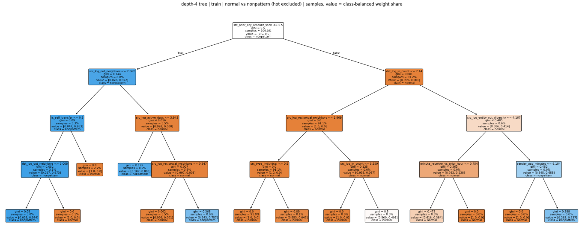

# 무패턴 vs 정상 lightGBM 결과

## 모델별 피처 구성

세 모델은 같은 데이터·설정(LightGBM)으로 학습하고 **입력 피처만** 다르다. 앞 모델에 묶음을 하나씩 더한 구조다.

| 모델 | 입력 | 열 수 | 바뀐 점 |
| --- | --- | ---: | --- |
| `v10` | 엣지 14 + 송신·수신 계좌 19 × 2 | 52 | v10 원래 피처(엣지 17 + 계좌 19)에서 팀원이 뺀 엣지 3개 제외 |
| `team41` | `v10` + 팀원 신규 12 | 64 | 팀원 최종 41종·64열과 같은 구성 |
| `team41_pair` | `team41` + 같은 분 같은 쌍 6 | 70 | 04 진단 결과로 추가한 피처 |

- 세 모델 모두 결제방식(`payment_format`)은 입력에 넣지 않았다 (팀원 41종 구성과 같음).

### v10 — 엣지 14 + 계좌 38

| 묶음 | 피처 |
| --- | --- |
| 엣지 14 | `pair_prior_count`, `pair_gap_minutes`, `pair_count_1h`, `sender_gap_minutes`, `sender_count_1h`, `receiver_gap_minutes`, `receiver_count_1h`, `paid_currency_z`, `reverse_history_count`, `pair_age_at_day_start`, `same_known_country`, `both_countries_known`, `same_currency`, `is_self_transfer` |
| 엣지에서 뺀 3 | `amt_z_pay_ccy`, `pair_history_count`, `same_entity` (팀원 41종에서 제외) |
| 계좌 19 (`src_`, `dst_` 각각) | `log_out_count`, `log_in_count`, `log_out_neighbors`, `log_in_neighbors`, `log_self_count`, `log_reciprocal_neighbors`, `mean_paid_currency_z`, `paid_outlier_fraction`, `log_currency_count`, `log_active_days`, `type_Corporation`, `type_Partnership`, `type_Sole_Proprietorship`, `type_Individual`, `type_Country`, `type_Direct`, `log_entity_observed_accounts`, `log_entity_out_diversity`, `log_entity_in_diversity` |

### team41 에서 더한 것 — 팀원 신규 8종 · 12열

| 피처 | 정의 |
| --- | --- |
| `minute_sender_vs_prior_hour` | ln(1 + 60 × 같은 분 송금 건수) − ln(1 + 직전 60분 송금 건수). 자기이체 제외, 현재 거래 포함 (06 에서 정의 C 선택) |
| `minute_receiver_vs_prior_hour` | 같은 식, 수신 계좌의 입금 기준 |
| `src_day_ccy_flow_balance` | 송신 계좌가 그날 지급통화로 받은 돈과 보낸 돈의 min / max (0 = 한쪽으로만) |
| `dst_day_ccy_flow_balance` | 같은 식, 수신 계좌·수취통화 기준 |
| `src_day_ccy_log_matching_in_amount` | ln(1 + 송신 계좌가 그날 같은 통화·같은 금액을 받은 횟수) |
| `src_prior_ccy_amount_seen` | 송신 계좌가 같은 통화·같은 금액을 전날까지 보낸 적이 있으면 1 |
| `dst_prior_ccy_amount_seen` | 수신 계좌가 같은 통화·같은 금액을 전날까지 받은 적이 있으면 1 |
| `src_prior_ccy_amount_vs_mean` | ln(1 + 이번 송금액 / 송신 계좌의 그 통화 평균 송금액, 전날까지). 이력 없으면 0 |
| `dst_prior_ccy_amount_vs_mean` | 같은 식, 수신 계좌의 입금 기준 |
| `src_day_ccy_rate_vs_prior` | ln(1 + 오늘 송금 건수) − ln(1 + 전날까지 건수 / 첫 활동일부터 달력 일수) |
| `dst_day_ccy_rate_vs_prior` | 같은 식, 수신 계좌의 입금 기준 |
| `pair_amount_seen_before_day` | 같은 송신 → 수신 쌍에서 같은 통화·같은 금액을 전날까지 본 적이 있으면 1 |

- 정의가 애매했던 곳은 05 노트북 맨 위 "정한 정의" 표에 적었다.
- 06 보정: `minute_*` 는 후보 4개 중 팀원 AUC 에 가장 가까운 C 를 골랐다. `src_day_ccy_log_matching_in_amount` 는 자기이체 자신을 빼도록 고쳤으나, 고치기 전 값이 팀원 수치와 더 맞아 다음 실행에서는 되돌릴 예정.

### team41_pair 에서 더한 것 — 같은 분 같은 쌍 6열 (04 진단)

| 피처 | 정의 |
| --- | --- |
| `pair_same_minute_other_n` | 같은 분에 같은 송신 → 수신 거래가 몇 건 더 있나 |
| `pair_same_minute_log_amount_ratio` | ln(1 + 내 금액) − 같은 분 같은 쌍 같은 통화 다른 거래들의 ln(1 + 금액) 평균. 없으면 0 |
| `pair_same_minute_is_max` | 같은 분 같은 쌍 같은 통화 거래가 2건 이상이고, 내 금액이 단독 최대면 1 |
| `pair_count_7d` | ln(1 + 같은 쌍의 최근 7일 거래 수). 누적 과거 건수가 기간에 따라 흔들리는 문제 때문에 고정 창으로 둠 |
| `receiver_same_minute_other_in_n` | 같은 분 수신 계좌의 다른 입금 수 |
| `receiver_same_minute_other_in_neighbors` | 같은 분 수신 계좌에 보낸 다른 송신 계좌 수 |

근거: 처음(0~1건) 보는 쌍이 같은 분에 2건을 보내면 "양성 1 + 정상 1" 쌍둥이가 되고, 양성 쪽 금액이 큰 경우가 70%였다 (아래 2번).

## 데이터 분포

| 구간 | 기간 | 정상 | 패턴 양성 | 무패턴 | 합계 | 무패턴 비율¹ | 무패턴 1건당 정상 |
|---|---|---:|---:|---:|---:|---:|---:|
| **전체** | 8/1 ~ 끝 | 179,476,533 | 137,936 | **87,610** | 179,702,079 | 0.0488% | 약 2,049건 |
| 이력만 | 8/1 ~ 8/7 | 14,925,801 | 1,795 | 5,411 | 14,933,007 | 0.0362% | 약 2,758건 |
| **Train** | 8/8 ~ 10/2 | 102,225,958 | 62,889 | **47,782** | 102,336,629 | 0.0467% | 약 2,139건 |
| **Val** | 10/3 ~ 10/16 | 24,379,251 | 20,100 | **13,695** | 24,413,046 | 0.0561% | 약 1,780건 |
| **Test** | 10/17 ~ 10/30 | 26,773,770 | 20,187 | **14,273** | 26,808,230 | 0.0533% | 약 1,876건 |
| 미사용 | 10/31 ~ 끝 | 11,171,753 | 32,965 | 6,449 | 11,211,167 | 0.0577% | 약 1,732건 |
| Train+Val+Test | 8/8 ~ 10/30 | 153,378,979 | 103,176 | **75,750** | 153,557,905 | 0.0494% | 약 2,025건 |

¹ 무패턴 / (정상 + 무패턴). 패턴 양성은 분모에 넣지 않음.

## 데이터 분석에서 의미 있다고 본 것

### 1. hot 15계좌는 구분이 안된다.

#### 나눈 기준 - 직전 무패턴 입금 후 경과(≤1시간 ~ 없음, 6칸)

은행 70의 송신계좌 15가 보낸 거래는 어떤 기준으로 나눠 봐도 약 0.14%(700건 중 1건)가 무패턴 라벨이다.

| 송신 계좌당 무패턴 | 계좌 수 | 무패턴 합계 |
| --- | ---: | ---: |
| 1건 | 42,798 | 42,798 |
| 2~9건 | 6,954 | 15,677 |
| 10~99건 | 0 | 0 |
| 100~999건 | 11 | 6,571 |
| 1000건 이상 | 4 | 16,115 |

- 대부분은 무패턴을 1~9건 보내는데 그런데 10~99건 구간이 통째로 비고, 100건 이상인 계좌가 딱 15개 있음. 이 15개를 hot이라고 부름(HOT_MIN = 300)
- 15개 모두 은행 70(National Bank of Indianapolis)이고, 소유주는 15명 모두 다르다.
- 이 계좌들이 보낸 거래는 무패턴 22,686건, 정상 16,000,508건, 패턴 양성 0건

#### 나눈 기준 - 직전 무패턴 입금 후 경과(≤1시간 ~ 없음, 6칸)

- hot 15계좌 거래를 "송신 계좌가 마지막으로 무패턴 입금을 받은 지 얼마나 지났나"를 시간 별로 봤을 때 일정함
  - ≤1시간(0.141) · ≤1일(0.143) · ≤7일(0.140) · ≤30일(0.144) · >30일(0.154) · 없음(0.139%)

#### 나눈 기준 - 같은 분 같은 쌍 다른 거래 있음 / 없음

- hot 15계좌 거래만 이 기준으로 두 칸으로 나눔
  - 같은 기준을 hot 밖 계좌에 적용하면 "있음" 칸이 약 1.9배 높다.

| 칸 | 정상 | 무패턴 | 칸별 무패턴 비율 |
| --- | ---: | ---: | --- |
| 같은 분 같은 쌍 다른 거래 없음 | 14,138,366 | 20,070 | **0.142%** |
| 같은 분 같은 쌍 다른 거래 있음 | 582,061 | 787 | **0.135%** |

- A가 B에게 처음 보내는 거래이고, 그 분에 1건만 보냄 = 무패턴 비율 0.55%
  - **평균(0.05%)의 약 11배. 처음 보는 상대라는 것만으로도 위험도가 오름**
- A가 B에게 처음 보내는데, 같은 분에 2건을 보냄 = 17.88%
  - **평균의 약 360배. 이런 거래 5~6건 중 1건이 무패턴**

#### 나눈 기준 - 금액, 결제방식, 과거 이력, 받은 뒤 출금(24시간 37.30% vs 37.57%), 같은 소유주의 다른 계좌

| 항목 | 정상 | 무패턴 |
| --- | ---: | ---: |
| USD 환산 송금액 중앙값 | $967.54 | $933.77 |
| Cheque 비중 | 47.84% | 51.05% |
| Credit Card 비중 | 30.37% | 32.29% |
| Cash 비중 | 19.65% | 15.02% |
| Bitcoin 비중 | 2.15% | 1.63% |

| 항목 | 정상 | 무패턴 |
| --- | ---: | ---: |
| 송신 계좌의 과거 24시간 거래 수 | 약 41,539건 | 약 42,628건 |
| 송신 계좌가 전날 보낸 서로 다른 수신 계좌 수 | 14,637개 | 14,637개 |
| 같은 송신 → 수신 쌍의 이전 거래 수 | 121건 | 120건 |

| 관찰 범위 | 입금 후 | 정상 | 무패턴 |
| --- | ---: | ---: | ---: |
| 수신 계좌 · 같은 통화 | 1시간 | 3.70% | 3.29% |
| 수신 계좌 · 같은 통화 | 24시간 | 37.30% | 37.57% |
| 수신 계좌 · 같은 통화 | 7일 | 53.90% | 54.54% |

| 관찰 범위 | 입금 후 | 정상 | 무패턴 |
| --- | ---: | ---: | ---: |
| 같은 소유주 전체 계좌 · 모든 통화 | 1시간 | 11.83% | 11.38% |
| 〃 | 24시간 | 56.82% | 57.04% |
| 〃 | 7일 | 73.52% | 73.95% |
| 수신 계좌는 출금 없고 같은 소유주의 다른 계좌가 출금 (24시간) |  | 17.31% | 16.79% |

> 위 피처(거래 정보, 소유주, 송신·수신 계좌와 소유주 전체의 과거 이력, 사후 분석용 이후 7일 흐름 요약)를 HistGradientBoosting에 넣고, hot 15계좌 거래만으로 정상 vs 무패턴을 학습을 때 다 AUC가 0.5 근처로 나옴

### 2. 같은 분 같은 쌍 쌍둥이

쌍둥이 : 그 분 이전에 A → B 거래가 0건 또는 1건이다(처음이거나 두 번째로 보는 쌍) and 그 분에 A → B 거래가 정확히 2건이다.

| 과거 쌍 거래 | 같은 분 다른 거래 | 정상 | 무패턴 | 무패턴 비율 |
| --- | ---: | ---: | ---: | ---: |
| 0 | 0 (혼자) | 4,467,952 | 24,534 | 0.55% |
| 0 | 1 (쌍둥이) | 12,274 | 2,673 | 17.88% |
| 1 | 0 | 2,698,409 | 12,764 | 0.47% |
| 1 | 1 (쌍둥이) | 1,240 | 1,197 | 49.12% |

#### 양성 1 + 정상 1 (쌍둥이 칸) 에서 두개를 항목 별로 비교

| 항목 | 쌍에 거래끼리 비교했을 때 |
| --- | ---: |
| 지급액 | 0.0% (항상 다름) |
| 지급통화 · 수취통화 | 100% |
| 결제방식 | 99.8% (대부분 ACH–ACH) |

#### 결제 금액은 다름

| 집단 | 칸 수 | 양성 쪽 금액이 더 큼 | ln(양성 금액 / 정상 금액) 중앙값 |
| --- | ---: | ---: | ---: |
| hot 밖 · ACH · 새 쌍 | 12,327 | 70.1% | 1.962 → e^1.962 ≈ 7.1배 |
| hot 밖 · ACH · 기존 쌍 | 1,163 | 36.6% | −0.743 → 0.48배 |
| hot · 기존 쌍 | 822 | 46.0% | −0.120 → 0.89배 |

### 3. 과거 쌍 이력

| 과거 쌍 거래 | 정상 | 무패턴 | ① 정상 중 비중 | ② 무패턴 중 비중 | ③ 칸별 무패턴 비율 |
| --- | ---: | ---: | ---: | ---: | ---: |
| 0 | 4,480,226 | 27,207 | 2.72% | 33.10% | 0.604% |
| 1 | 2,699,649 | 13,961 | 1.64% | 16.98% | 0.514% |
| 2~5 | 8,684,809 | 13,344 | 5.28% | 16.23% | 0.153% |
| 6~20 | 17,043,003 | 6,990 | 10.36% | 8.50% | 0.041% |
| 21+ | 131,626,599 | 20,697 | 80.00% | 25.18% | 0.016% |
| 전체 | 164,534,286 | 82,199 | 100% | 100% | 0.050% |

- 무패턴 82,199건 중 27,207건(33.1%)이 처음 보는 상대에게 보낸 거래
- 정상 1억 6,450만 건 중에서는 448만 건(2.7%)만

### 4. ACH에 쏠려있음

| 결제 방식 | 정상 | 정상 중 비중 | 무패턴 | 무패턴 중 비중 | 칸별 무패턴 비율 | 패턴 양성 |
| --- | ---: | ---: | ---: | ---: | ---: | ---: |
| ACH | 21,927,007 | 12.22% | 61,245 | 69.91% | 0.2785% | 137,919 |
| Cheque | 70,572,843 | 39.32% | 13,260 | 15.14% | 0.0188% | 0 |
| Credit Card | 50,848,272 | 28.33% | 7,846 | 8.96% | 0.0154% | 0 |
| Cash | 18,409,318 | 10.26% | 3,663 | 4.18% | 0.0199% | 0 |
| Bitcoin | 3,903,312 | 2.17% | 1,595 | 1.82% | 0.0408% | 13 |
| Wire | 6,405,226 | 3.57% | 1 | 0.00% | 0.00002% | 4 |
| Reinvestment | 7,410,555 | 4.13% | 0 | 0% | 0% | 0 |
| 전체 | 179,476,533 | 100% | 87,610 | 100% | 0.0488% | 137,936 |

#### ACH가 아닌 무패턴은 대부분 hot 15계좌에서 나옴

| 결제 방식 | 무패턴 전체 | 그중 hot(근사) | hot 몫 |
| --- | ---: | ---: | ---: |
| Cheque | 13,260 | 약 11,730 | 약 88% |
| Credit Card | 7,846 | 약 7,420 | 약 95% |
| Cash | 3,663 | 약 3,450 | 약 94% |
| Bitcoin | 1,595 | 약 375 | 약 24% |

> - ACH 무패턴(약 70%): hot 밖 계좌. 처음 보는 쌍, 처음 보는 금액, 같은 분 쌍둥이 같은 신호가 여기서 나옴.
> - 비ACH 무패턴(약 30%): 대부분 hot 15계좌. 앞에서 본 것처럼 정상과 구분되지 않는다.

### 5. 처음 보는 금액·당일 흐름 균형 (9/26–10/4)

- 송신 계좌가 이 거래의 (지급통화, 지급액)을 전날까지 보낸 적이 있으면 1, 없으면 0

| 구분 | 정상 | 무패턴 | 팀원(정상 / 무패턴) |
| --- | ---: | ---: | --- |
| 처음 보는 금액(=0) 비율, 전체 | 10.66% | 72.90% | 10.72% / 72.90% |
| ACH | 19.58% | 100.00% | 19.79% / 100% |
| 비ACH | 9.50% | 7.70% | — |

### 6. 받은 계좌가 같은 분에 다시 보내면 무패턴이 거의 없다

- 거래 A → B가 있을 때, 같은 분에 수신 계좌 B가 다른 곳으로 보낸 거래 수를 셈

| 과거 쌍 거래 | B 같은 분 출금 0건: 정상 / 무패턴 / 비율 | 1건: 정상 / 무패턴 / 비율 | 비율 차이 |
| --- | ---: | ---: | ---: |
| 0 | 4,439,007 / 27,195 / 0.609% | 40,206 / 12 / 0.030% | 1/20 |
| 1 | 2,658,566 / 13,952 / 0.522% | 33,892 / 7 / 0.021% | 1/25 |
| 2~5 | 8,464,954 / 13,332 / 0.157% | 187,636 / 7 / 0.004% | 1/42 |
| 6~20 | 16,735,442 / 6,970 / 0.042% | 248,665 / 8 / 0.003% | 1/13 |
| 21+ | 129,258,742 / 20,674 / 0.016% | 2,248,576 / 21 / 0.001% | 1/17 |

## 결과

### 임계값별 np_only
| 임계값 | val_P_% | val_R_% | val_알림(추정) | test_P_% | test_R_% | test_R_hot안_% | test_R_hot밖_% | test_알림 | test_무패턴_잡힘 | test_정상_오탐 |
| ---: | ---: | ---: | ---: | ---: | ---: | ---: | ---: | ---: | ---: | ---: |
| 0.05 | 5.61 | 66.32 | 161,932 | 5.39 | 66.73 | 0.00 | 89.05 | 176,724 | 9,524 | 167,200 |
| 0.10 | 7.09 | 63.26 | 122,263 | 7.07 | 62.83 | 0.00 | 83.85 | 126,778 | 8,968 | 117,810 |
| 0.15 | 7.64 | 61.06 | 109,411 | 7.67 | 60.35 | 0.00 | 80.54 | 112,315 | 8,614 | 103,701 |
| 0.20 | 7.90 | 58.84 | 102,007 | 7.95 | 58.12 | 0.00 | 77.57 | 104,300 | 8,296 | 96,004 |
| 0.25 | 7.94 | 55.71 | 96,128 | 8.13 | 55.11 | 0.00 | 73.55 | 96,789 | 7,866 | 88,923 |
| 0.30 | 8.22 | 41.23 | 68,646 | 8.57 | 42.23 | 0.00 | 56.35 | 70,332 | 6,027 | 64,305 |
| 0.35 | 18.36 | 11.00 | 8,207 | 15.39 | 13.55 | 0.00 | 18.08 | 12,568 | 1,934 | 10,634 |
| 0.40 | 46.69 | 7.35 | 2,157 | 39.66 | 8.84 | 0.00 | 11.80 | 3,182 | 1,262 | 1,920 |
| 0.45 | 53.19 | 7.05 | 1,816 | 50.42 | 8.39 | 0.00 | 11.20 | 2,376 | 1,198 | 1,178 |
| 0.50 | 55.96 | 6.96 | 1,703 | 52.73 | 8.32 | 0.00 | 11.10 | 2,251 | 1,187 | 1,064 |
| 0.55 | 57.52 | 6.92 | 1,648 | 54.15 | 8.27 | 0.00 | 11.03 | 2,179 | 1,180 | 999 |
| 0.60 | 59.04 | 6.84 | 1,587 | 55.04 | 8.22 | 0.00 | 10.97 | 2,131 | 1,173 | 958 |
| 0.65 | 58.83 | 6.78 | 1,579 | 55.84 | 8.08 | 0.00 | 10.78 | 2,065 | 1,153 | 912 |
| 0.70 | 58.04 | 6.56 | 1,549 | 57.09 | 7.76 | 0.00 | 10.35 | 1,939 | 1,107 | 832 |
| 0.75 | 62.91 | 6.19 | 1,348 | 59.21 | 7.27 | 0.00 | 9.71 | 1,753 | 1,038 | 715 |
| 0.80 | 64.16 | 5.23 | 1,116 | 62.99 | 6.13 | 0.00 | 8.18 | 1,389 | 875 | 514 |
| 0.85 | 72.03 | 3.76 | 715 | 71.33 | 4.32 | 0.00 | 5.77 | 865 | 617 | 248 |
| 0.90 | 84.76 | 2.03 | 328 | 81.60 | 2.14 | 0.00 | 2.86 | 375 | 306 | 69 |
| 0.95 | 100.00 | 0.13 | 18 | 100.00 | 0.12 | 0.00 | 0.16 | 17 | 17 | 0 |

### 결제방식별 — np_only, 임계값 0.5 (test)

| 결제방식 | 무패턴 | 무패턴_잡힘 | R_% | 정상 | 정상_오탐 | 알림 | P_% |
| --- | ---: | ---: | ---: | ---: | ---: | ---: | ---: |
| ACH | 10,387 | 1,134 | 10.92 | 3,191,207 | 1,035 | 2,169 | 52.28 |
| Cheque | 1,949 | 38 | 1.95 | 10,211,947 | 14 | 52 | 73.08 |
| Credit Card | 1,168 | 0 | 0.00 | 7,342,052 | 0 | 0 | — |
| Cash | 523 | 0 | 0.00 | 2,664,707 | 0 | 0 | — |
| Bitcoin | 246 | 15 | 6.10 | 582,228 | 15 | 30 | 50.00 |
| Reinvestment | 0 | 0 | — | 1,852,514 | 0 | 0 | — |
| Wire | 0 | 0 | — | 929,115 | 0 | 0 | — |

### 결제방식 × hot — np_only, 임계값 0.5 (test, 무패턴이 있는 칸만)

| 결제방식 | hot | 무패턴 | 무패턴_잡힘 | R_% | 정상 | 정상_오탐 | 알림 | P_% |
| --- | --- | ---: | ---: | ---: | ---: | ---: | ---: | ---: |
| ACH | hot 밖 | 10,387 | 1,134 | 10.92 | 3,191,207 | 1,035 | 2,169 | 52.28 |
| Bitcoin | hot 안 | 69 | 0 | 0.00 | 53,133 | 0 | 0 | — |
| Bitcoin | hot 밖 | 177 | 15 | 8.47 | 529,095 | 15 | 30 | 50.00 |
| Cash | hot 안 | 521 | 0 | 0.00 | 487,386 | 0 | 0 | — |
| Cash | hot 밖 | 2 | 0 | 0.00 | 2,177,321 | 0 | 0 | — |
| Cheque | hot 안 | 1,822 | 0 | 0.00 | 1,183,315 | 0 | 0 | — |
| Cheque | hot 밖 | 127 | 38 | 29.92 | 9,028,632 | 14 | 52 | 73.08 |
| Credit Card | hot 안 | 1,166 | 0 | 0.00 | 751,132 | 0 | 0 | — |
| Credit Card | hot 밖 | 2 | 0 | 0.00 | 6,590,920 | 0 | 0 | — |

### 쌍둥이 칸 — np_only, 임계값 0.5 (test)

| 구분 | 무패턴 | 무패턴_잡힘 | R_% | 정상 | 정상_오탐 | 알림 | P_% |
| --- | ---: | ---: | ---: | ---: | ---: | ---: | ---: |
| 쌍둥이 칸 | 1,094 | 1,069 | 97.71 | 39,122 | 966 | 2,035 | 52.53 |
| 쌍둥이 칸 · hot 밖 | 1,089 | 1,069 | 98.16 | 35,715 | 966 | 2,035 | 52.53 |
| 그 밖 | 13,179 | 118 | 0.90 | 26,734,648 | 98 | 216 | 54.63 |
| 그 밖 · hot 밖 | 9,606 | 118 | 1.23 | 24,263,089 | 98 | 216 | 54.63 |

### 피처 중요도 — np_only (gain 상위 25)

| 순위 | 피처 | 정의 | gain | split | gain_% |
| ---: | --- | --- | ---: | ---: | ---: |
| 1 | `src_prior_ccy_amount_seen` | 송신 계좌가 같은 통화·같은 금액을 전날까지 보낸 적이 있으면 1 | 2,920,720 | 183 | 28.89 |
| 2 | `minute_sender_vs_prior_hour` | 송신 계좌의 이번 분 송금 건수(×60) vs 직전 60분 송금 건수, 자기이체 제외 | 2,772,700 | 728 | 27.43 |
| 3 | `src_log_entity_in_diversity` | 송신 계좌 소유주에게 돈을 보낸 상대 다양성 | 669,028 | 799 | 6.62 |
| 4 | `src_log_out_neighbors` | 송신 계좌가 돈을 보낸 상대 계좌 수 (누적) | 534,525 | 336 | 5.29 |
| 5 | `src_log_entity_observed_accounts` | 송신 계좌 소유주가 가진 계좌 수 | 421,058 | 510 | 4.17 |
| 6 | `dst_day_ccy_rate_vs_prior` | 수신 계좌의 오늘 입금 건수 vs 평소 하루 입금 건수 | 241,851 | 737 | 2.39 |
| 7 | `src_log_in_neighbors` | 송신 계좌에 돈을 보낸 상대 계좌 수 (누적) | 219,451 | 427 | 2.17 |
| 8 | `src_prior_ccy_amount_vs_mean` | 이번 송금액 / 송신 계좌의 그 통화 평소 평균 송금액 (전날까지) | 211,090 | 454 | 2.09 |
| 9 | `src_mean_paid_currency_z` | 송신 계좌의 평소 송금 금액 크기 평균 | 176,835 | 590 | 1.75 |
| 10 | `is_self_transfer` | 자기 계좌로 보낸 거래인지 (0/1) | 152,864 | 112 | 1.51 |
| 11 | `src_day_ccy_rate_vs_prior` | 송신 계좌의 오늘 송금 건수 vs 평소 하루 송금 건수 | 145,379 | 367 | 1.44 |
| 12 | `sender_count_1h` | 송신 계좌의 최근 1시간 송금 수 | 123,419 | 195 | 1.22 |
| 13 | `dst_log_entity_observed_accounts` | 수신 계좌 소유주가 가진 계좌 수 | 105,270 | 616 | 1.04 |
| 14 | `paid_currency_z` | 통화별로 맞춘 송금액 크기 (강건 z) | 102,766 | 1,126 | 1.02 |
| 15 | `src_log_self_count` | 송신 계좌의 자기이체 수 (누적) | 94,960 | 277 | 0.94 |
| 16 | `src_paid_outlier_fraction` | 송신 계좌의 송금 중 큰 금액(이상치) 비율 | 84,590 | 187 | 0.84 |
| 17 | `src_log_entity_out_diversity` | 송신 계좌 소유주가 돈을 보낸 상대 다양성 | 81,292 | 541 | 0.80 |
| 18 | `dst_log_in_neighbors` | 수신 계좌에 돈을 보낸 상대 계좌 수 (누적) | 80,396 | 714 | 0.80 |
| 19 | `pair_prior_count` | 같은 송신 → 수신 쌍의 과거 거래 수 (같은 분 제외) | 77,393 | 556 | 0.77 |
| 20 | `pair_count_1h` | 같은 쌍의 최근 1시간 거래 수 | 66,056 | 87 | 0.65 |
| 21 | `src_log_active_days` | 송신 계좌의 거래가 있었던 날 수 (누적) | 59,441 | 416 | 0.59 |
| 22 | `reverse_history_count` | 반대 방향(B → A) 전날까지 거래 수 | 57,710 | 264 | 0.57 |
| 23 | `pair_count_7d` | 같은 쌍의 최근 7일 거래 수 | 54,031 | 243 | 0.53 |
| 24 | `src_day_ccy_flow_balance` | 송신 계좌가 그날 그 통화로 받은 돈과 보낸 돈의 균형 (min/max, 0 = 한쪽으로만) | 51,800 | 430 | 0.51 |
| 25 | `src_log_in_count` | 송신 계좌가 받은 거래 수 (누적) | 49,776 | 427 | 0.49 |

### 결정트리



```
|--- src_prior_ccy_amount_seen <= 0.500
|   |--- src_log_out_neighbors <= 2.862
|   |   |--- is_self_transfer <= 0.500
|   |   |   |--- dst_log_out_neighbors <= 3.068
|   |   |   |   |--- class: 1
|   |   |   |--- dst_log_out_neighbors >  3.068
|   |   |   |   |--- class: 0
|   |   |--- is_self_transfer >  0.500
|   |   |   |--- class: 0
|   |--- src_log_out_neighbors >  2.862
|   |   |--- src_log_active_days <= 3.942
|   |   |   |--- class: 1
|   |   |--- src_log_active_days >  3.942
|   |   |   |--- src_log_reciprocal_neighbors <= 0.347
|   |   |   |   |--- class: 0
|   |   |   |--- src_log_reciprocal_neighbors >  0.347
|   |   |   |   |--- class: 1
|--- src_prior_ccy_amount_seen >  0.500
|   |--- dst_log_in_count <= 7.140
|   |   |--- src_log_reciprocal_neighbors <= 1.869
|   |   |   |--- src_type_Individual <= 0.500
|   |   |   |   |--- class: 0
|   |   |   |--- src_type_Individual >  0.500
|   |   |   |   |--- class: 0
|   |   |--- src_log_reciprocal_neighbors >  1.869
|   |   |   |--- src_log_in_count <= 5.559
|   |   |   |   |--- class: 0
|   |   |   |--- src_log_in_count >  5.559
|   |   |   |   |--- class: 0
|   |--- dst_log_in_count >  7.140
|   |   |--- src_log_entity_out_diversity <= 4.167
|   |   |   |--- minute_receiver_vs_prior_hour <= 0.754
|   |   |   |   |--- class: 0
|   |   |   |--- minute_receiver_vs_prior_hour >  0.754
|   |   |   |   |--- class: 0
|   |   |--- src_log_entity_out_diversity >  4.167
|   |   |   |--- sender_gap_minutes <= 9.184
|   |   |   |   |--- class: 0
|   |   |   |--- sender_gap_minutes >  9.184
|   |   |   |   |--- class: 1
```